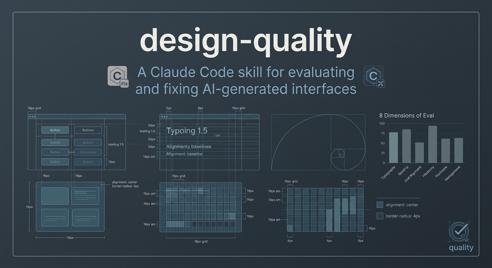
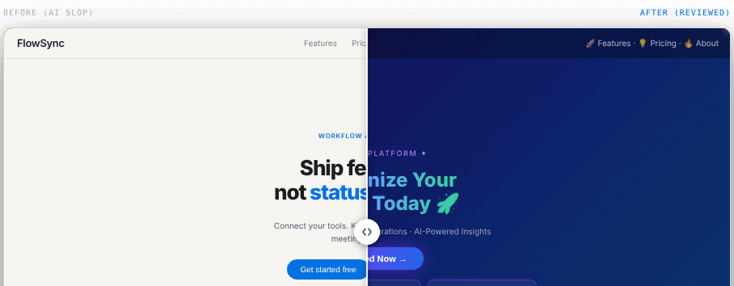

[English](README.md) · [Español](README.es.md) · [Português (Brasil)](README.pt-BR.md) · [简体中文](README.zh-CN.md) · [Français](README.fr.md) · **Deutsch** · [日本語](README.ja.md) · [한국어](README.ko.md)

---

    

**[→ Live-Demo: romulorogerio.github.io/design-quality](https://romulorogerio.github.io/design-quality)**



## Demo



# design-quality

Eine Design-Quality-Skill für KI-Coding-Assistenten — Claude Code, Cursor, Codex, Copilot oder jedes Tool, das Markdown-Anweisungen akzeptiert.

KI generiert UIs schnell. Sie generiert sie auch falsch, immer auf die gleiche Weise. Violett-blaue Verläufe, Farbverlauf-Text, leuchtende Ränder, Emojis als Icons, Karten-Grids ohne Inhalt, Inter-only Typografie, riesige Hero-Headlines auf operativen Tools. Das sind die Erkennungszeichen. Diese Skill erkennt sie, bewertet das Interface auf 8 Dimensionen und korrigiert sie Schritt für Schritt.

Funktioniert mit React, Tailwind, HTML/CSS, Vue, Svelte, Dashboards, Apps, Landing Pages, Komponenten.


---

## Schnellstart

### Mit Claude Code (CLI)

```bash
# Global installieren
claude skills install https://github.com/RomuloRogerio/design-quality

# Oder direkt kopieren
cp -r skills/design-quality ~/.claude/skills/
```

In jeder Claude Code-Sitzung lädt die Skill dann automatisch, wenn Sie Claude bitten, eine UI zu überprüfen, zu kritisieren oder zu erstellen.

<details>
<summary>🔍 Beispiel Terminal-Ausgabe: Review Mode</summary>

```
$ claude review this design

🤖 [design-quality] Analyzing repository and screenshot context...
✨ Found 4 AI-slop indicators. Evaluating against 8-dimension scorecard.

## Slop Audit
❌ Purple-to-blue gradient background (P1) — App.css line 12
❌ Gradient text with background-clip (P1) — HeroTitle component
❌ Emoji in navigation label "🚀 Launch" (P1) — Navbar.tsx
❌ ALL CAPS tracked section header (P1) — features section

## Template Check
Could this UI belong to any other SaaS product? YES → P1
No World reference, no Signature detail found.

## Scorecard
Product fit:    4/10   generic SaaS applied
Hierarchy:      6/10   primary action visible but competing elements
Clarity:        7/10   labels readable, states missing
Taste:          3/10   templated
Restraint:      2/10   excessive decoration
Density:        6/10   appropriate for content
Craft:          5/10   grid inconsistent in footer
Responsiveness: 7/10   mobile layout works
Overall:        5/10

## Verdict
Best part: clear primary CTA, readable label
Worst part: gradient + gradient text — maximum slop signal
Required fix (P0): none
Quick wins (P1): remove gradient background, strip gradient text, replace emoji icons
```

</details>

### Mit jedem KI-Assistenten (Cursor, Codex, Copilot, Gemini…)

Füge den Skill-Dateiinhalt direkt in deinen Chat ein oder füge ihn als Kontext/System-Prompt hinzu:

```
# Im KI-Chat:
"Nutze diesen Skill zur Überprüfung meiner UI: [füge den Inhalt von skills/design-quality/SKILL.md ein]"

# Oder referenziere die Datei in der Agentenkonfiguration:
skills/design-quality/SKILL.md   → UI-Überprüfung
skills/ant-design.md              → Ant Design Audit
skills/system-design.md           → Architekturplanung
skills/all.md                     → Alle drei gleichzeitig
```

Die Skills sind reines Markdown — keine Claude Code Abhängigkeit. Das Plugin (Slash-Befehle) ist Claude Code exklusiv.

### Mit Claude.ai Projects

Laden Sie `skills/design-quality/SKILL.md` und alle Dateien in `skills/design-quality/references/` als Projektwissen hoch. Claude wendet die Skill auf UI-bezogene Anfragen an.

---

## Verwendungsbeispiele

**Eine UI reviewen und bewerten:**
```
dieses Design überprüfen
diese UI kritisieren
sieht das KI-generiert aus?
generisches entfernen
```

**Eine neue UI mit Produktrichtung zuerst beginnen:**
```
ein Dashboard für ein Flottenüberwachungstool bauen
den Onboarding-Fluss einer Rechnungsapp für Freelancer gestalten
```

**Korrektur-Durchläufe auf bestehendem Code ausführen:**
```
Abstände und Farben in dieser Komponente korrigieren
einen vollständigen Korrektions-Durchlauf auf App.tsx ausführen
```

**Ant Design Audit:**
```
dieses React-Admin-Panel anhand der Ant Design-Standards überprüfen
prüfen ob diese Komponente den Ant Design Token-Regeln entspricht
```

**Architekturplanung:**
```
einen URL-Shortener entwerfen, der 100M Anfragen/Tag unterstützt
wie soll ich von Nutzern hochgeladene Videos in großem Maßstab speichern und bereitstellen?
```

---

## Skills in diesem Repository

| Skill | Datei | Wofür |
|---|---|---|
| **design-quality** | [`skills/design-quality/SKILL.md`](skills/design-quality/SKILL.md) | Allgemeine UI-Prüfung, KI-Klischee-Erkennung, 8-Dimensionen-Scorecard, Create/Fix/Polish-Modi |
| **ant-design** | [`skills/ant-design.md`](skills/ant-design.md) | Ant Design v6 Review: Tokens, Komponenten, 4px-Raster, Motion, Elevation |
| **system-design** | [`skills/system-design.md`](skills/system-design.md) | Skalierbare Architektur: 5-Schritte-Framework, DB-Auswahl, Caching, Queues, CAP |
| **all** | [`skills/all.md`](skills/all.md) | Alle drei auf einmal laden; Claude wählt automatisch die passende |

---

## Plugin (Claude Code Slash-Befehle)

Der `plugin/`-Ordner fügt jeder Claude Code-Sitzung vier Slash-Befehle und einen Statusleisten-Hinweis hinzu.

| Befehl | Was er tut |
|---|---|
| `/dq-review` | Vollständiges UI-Audit: KI-Erkennung, 8-Dimensionen-Scorecard, P0–P3-Korrektuliste |
| `/direction` | Create-Modus: leitet Richtung ab (Charakter · Welt · Momente · Signatur) vor jedem UI-Code |
| `/fix` | Fix-Modus: 10 sequenzielle Passes: Abstände → Farbe → Icons → Copy → Typografie → Layout → Details → A11y → Visuals → Motion |
| `/polish` | Polish-Modus: geht jeden Zustand mit 10 % Geschwindigkeit durch (hover · focus · active · loading · empty · error) |

Nach dem Bearbeiten einer `.tsx`-, `.jsx`-, `.css`-, `.scss`-, `.html`-, `.vue`- oder `.svelte`-Datei zeigt die Statusleiste `/dq-review · /fix · /polish` als Erinnerung.

**Installieren:**
```bash
# Repository klonen
git clone https://github.com/RomuloRogerio/design-quality

# Claude Code mit dem Plugin starten
claude --plugin-dir ~/design-quality/plugin
```

**Oder dauerhaft laden:** zu `~/.claude/settings.json` hinzufügen:
```json
{
  "pluginDirs": ["~/design-quality/plugin"]
}
```

---

## Das gelöste Problem

### Wie KI-UIs aussehen

Wenn ein LLM eine UI ohne Einschränkungen generiert, produziert es jedes Mal dieselbe Schnittstelle. Es hat Tausende von Dribbble-Screenshots, Portfolio-Stücken und SaaS-Landingpages gesehen. Es optimiert für "beeindruckend auf den ersten Blick" statt "nützlich in der Praxis."

Das Ergebnis ist immer erkennbar:

**Farbe:** Violett-blauer Verlaufshintergrund. Verlaufstext mit `background-clip: text`. Leuchtende farbige Ränder. Radiale Farbtupfer hinter dem Inhalt.

**Typografie:** Riesige Hero-Headlines auf operativen Tools. ALL CAPS-Etiketten mit Tracking auf jedem Abschnitt. Emojis in Beschriftungen gemischt ("🚀 Starten", "Neu ✨"). Nur Inter oder Roboto ohne andere typografische Entscheidung.

**Layout:** Drei-Spalten-Karten-Grid als Füllmaterial. Alles zentriert. Dunkles Theme ohne Produktgrund angewendet. Jeder Abschnitt mit demselben Abstand.

**Copy:** "Revolutionieren Sie Ihren Workflow Heute." "Leistungsstarke Integrationen." "Erweiterte Analytik." Copy, die zu jedem Produkt der Kategorie passen könnte.

**Identität:** Wenn Sie den Produktnamen durch einen Konkurrenten ersetzen würden, würde das Interface immer noch passen. Keine Welt, keine Signatur, keine Momente: nichts, was nur dieses Produkt hätte.

### Was diese Skill anders macht

Sie erkennt diese Muster systematisch, bewertet was vorhanden ist und korrigiert in der richtigen Reihenfolge. Sie verhindert sie auch im Voraus, indem sie eine Produktrichtung verlangt, bevor eine UI geschrieben wird.

---

## Modi

### Überprüfungsmodus

Eingabe: Screenshot, HTML/CSS-Quellcode, Projektordner, URL oder Artefakt-Link.

Ausgabe:
```
## KI-Klischee-Audit
[jeder Fund mit Ort und Schweregrad]

## Vorlagen-Prüfung
[würde das zu jedem Produkt der Kategorie passen?]

## Bewertungskarte
Produktpassung:    X/10   [einzeiliger Hinweis]
Hierarchie:        X/10
Klarheit:          X/10
Geschmack:         X/10
Zurückhaltung:     X/10
Dichte:            X/10
Craft:             X/10
Responsivität:     X/10
Gesamt:            X/10

## Urteil
Bester Teil:
Schlechtester Teil:
Erforderliche Korrektur (P0): [falls vorhanden]
Schnelle Gewinne (P1): [Top 3]
```

Schweregradskala:
- **P0:** bricht Nutzbarkeit oder Lesbarkeit. Vor allem anderen korrigieren.
- **P1:** lässt es eindeutig KI-generiert aussehen.
- **P2:** schwächt das Craft, ohne es zu brechen.
- **P3:** wünschenswerte Verbesserung.

### Erstellungsmodus

Bevor eine UI geschrieben wird, verlangt die Skill:
1. **Kontexttyp:** App-Bildschirm (Dichte bestimmt) vs. Seite (Komposition bestimmt)
2. **Produktverständnis:** was es tut, für wen, was die Hauptaufgabe ist
3. **Richtung:** fünf Linien aus dem Produkt abgeleitet: Produkt, Charakter, Welt, Momente, Signatur
4. **Design-Regler:** drei Knöpfe als schnelles Signal: Varianz / Bewegung / Dichte (1–10 jeweils)

Nach Bestätigung wird eine `PROJECT_DESIGN.md` im Projektstamm erstellt, die die Richtung über Sitzungen hinweg beibehält. Zukünftige Sitzungen lesen diese Datei zuerst: die Richtung driftet nicht.

Richtungsbeispiel für ein Zeiterfassungs-Tool:
```
Produkt: Zeiterfassung für Freelancer, die Zeiterfassung hassen.
Charakter: ruhig, präzise, ein wenig warm
Welt: Uhren, Zeitanzeigen, ruhige Fokus-Sitzungen
Momente: Die Wochenansicht, in der sich Stunden ansammeln; der Moment der Rechnungserstellung
Signatur: Eine subtile Sekundenzeiger-Animation am aktiven Timer
```

### Korrektionsmodus

Zehn sequenzielle Durchläufe: jeden abschließen, bevor der nächste beginnt:

1. **Abstände:** 8px-Raster-Ausrichtung, Rhythmus, Gruppierung
2. **Farbe:** Klischees entfernen, aus einem neutralen Verlauf aufbauen
3. **Icons:** eine Bibliothek, eine Größe, ein Strichstärke, `currentColor`
4. **Copy:** Emoji-Beschriftungen entfernen, das Schreien beruhigen, Copy produktspezifisch machen
5. **Typografie:** Hierarchie, Gewichte, `text-wrap: balance` auf Überschriften
6. **Layout:** Ausrichtung, Dichte
7. **Details:** konzentrische Radien, Schatten (nicht Schatten UND Rand gleichzeitig), Ränder
8. **Barrierefreiheit und Touch:** Fokuszustände, `aria-label`, `touch-action: manipulation`, 44px-Ziele
9. **Visuals:** Leerzustand-Illustrationen, Icon-Konsistenz, Bild-Seitenverhältnisse
10. **Bewegung:** letzter Durchlauf, nur dort, wo er Bedeutung hinzufügt

### Verfeinerungsmodus

Für Interfaces, die größtenteils gut gestaltet sind, sich aber leicht falsch anfühlen.

Technik: das Interface in DevTools (Animations-Panel) auf 10% Geschwindigkeit verlangsamen. Jeden Zustand durchlaufen: hover, focus, active, loading, empty. Was sich bei 10% falsch anfühlt, ist das, was bei voller Geschwindigkeit falsch ist.

---

## Bewertungskarten-Dimensionen

| Dimension | Die Frage, die sie stellt |
|---|---|
| **Produktpassung** | Entspricht die visuelle Richtung der tatsächlichen Aufgabe und Zielgruppe des Produkts? |
| **Hierarchie** | Kann der Benutzer sehen, was zuerst, zweitens, drittens wichtig ist? |
| **Klarheit** | Sind Beschriftungen, Aktionen, Daten und Zustände leicht verständlich? |
| **Geschmack** | Fühlt es sich intentional an, ohne wie eine Vorlage auszusehen? |
| **Zurückhaltung** | Keine unnötige Dekoration, Füllmaterial oder Style-Cosplay? |
| **Dichte** | Ist die Informationsmenge für die Aufgabe richtig? |
| **Craft** | Abstände, Typografie, Ausrichtung, Kontrast, Komponentenzustände: poliert? |
| **Responsivität** | Übersteht das Design Mobile und schmale Layouts? |

---

## Erkannte Antimuster

### Farbe und Effekte (100+ Muster)

| Muster | Schweregrad |
|---|---|
| Violett-blauer Verlauf auf Hintergrund, Karte oder Button | `P1` |
| Jeder Farbton-zu-Farbton-Verlauf auf einer Fläche | `P1` |
| Verlaufstext (`background-clip: text`) | `P1` |
| Leuchtender Rand (`box-shadow` mit gesättigter Farbe) | `P1` |
| Radiale Farbkugel / atmosphärische Wäsche hinter dem Inhalt | `P1` |
| Hintergrund, der auf einem App-Bildschirm als Farbton lesbar ist | `P1` |
| Farbiger Schatten auf Karten oder Buttons | `P2` |
| "Glassmorphismus"-Unschärfe ohne bedeutsamen Ebenengrund | `P2` |

### Typografie

| Muster | Schweregrad |
|---|---|
| Emojis in Beschriftungen oder Überschriften ("Neu ✨", "🚀 Starten") | `P1` |
| ALL CAPS-Etiketten mit Tracking auf jedem Abschnitts-Header | `P1` |
| Riesige Hero-Überschrift auf einem funktionalen operativen Tool | `P1` |
| Copy, die schreit ("Revolutionieren Sie Ihren Workflow Heute") | `P1` |
| Nur Inter ohne andere typografische Entscheidung | `P2` |
| Kein visueller Gewichtsunterschied zwischen Überschrift und Fließtext | `P1` |

### Layout und Struktur

| Muster | Schweregrad |
|---|---|
| Gleichmäßig abstandsbasiertes 3-Spalten-Karten-Grid als Inhaltsfüller | `P1` |
| Doppelte Feature-Karten (Icon + Überschrift + zwei Sätze jeweils) | `P1` |
| Dunkles Dashboard standardmäßig ohne Produktgrund angewendet | `P1` |
| Abschnitt existiert nur zum Füllen von Raum (gefälschte Statistiken, erfundene Testimonials) | `P1` |
| Keine visuelle Hierarchie: jedes Element mit demselben Gewicht | `P1` |
| Alles zentriert, kein linksbündiges Lesemuster | `P2` |

### Icons

| Muster | Schweregrad |
|---|---|
| Emojis als Icons in Navigation oder Karten verwendet | `P1` |
| Zwei oder mehr Icon-Bibliotheken auf einem Bildschirm gemischt | `P2` |
| Icons mit eigenen Farben (nicht `currentColor`) | `P2` |
| Dekorative Icons vor jeder Überschrift oder Beschriftung | `P2` |

### Vorlagen-Identität

| Muster | Schweregrad |
|---|---|
| Produktname durch Konkurrenten ersetzen: UI passt immer noch | `P1` |
| Kein Signatur-Detail: nichts, was nur dieses Produkt hätte | `P1` |
| Keine Welt-Referenz: Neutrale haben keine Tönung in Richtung der Produktdomäne | `P2` |
| Generische Stock-Illustration, die zu jedem Produkt passen könnte | `P2` |

### Barrierefreiheit und Technik

| Muster | Schweregrad |
|---|---|
| Textkontrast unter 4.5:1 (WCAG AA) | `P0` |
| Kein sichtbarer Fokusindikator auf interaktiven Elementen | `P0` |
| Icon-Button ohne `aria-label` | `P1` |
| Formulareingabe ohne zugeordnetes `<label>` | `P1` |
| `user-scalable=no` im Viewport-Meta | `P1` |
| `prefers-reduced-motion` nicht respektiert | `P1` |
| `transition: all` statt spezifischer Eigenschaften | `P2` |
| Sich überlappende Chart-Beschriftungen | `P0` |

### Mobile und Touch

| Muster | Schweregrad |
|---|---|
| Touch-Ziele kleiner als 44×44px | `P1` |
| Hover-Effekte ohne `@media (hover: hover)`-Schutz | `P2` |
| `touch-action: manipulation` bei Buttons fehlend | `P2` |
| `overscroll-behavior: contain` bei Modals fehlend | `P2` |

---

## Richtungsrahmen

Die fünf Linien, die jedes Design vor dem Schreiben von Code braucht:

**Produkt:** was es tut und für wen, ein einfacher Satz.

**Charakter:** 2–3 konkrete Wörter. `ruhig, präzise, ein wenig warm` oder `schnell, technisch, verspielt`.
Verboten: sauber, modern, elegant, minimal, premium. Diese beschreiben jede Vorlage.

**Welt:** das Material oder der Ort, zu dem das Produkt natürlich gehört.
- Notiz-App → Papier und Tinte
- Monitoring-Tool → Instrumente und Nachtschichten
- Reise-App → Karten und Fensterlicht
- Finanz-Tool → Hauptbücher, saubere Spalten, ruhige Autorität

Das tönt die Neutralen, den Akzent und die visuellen Momente.

**Momente:** 1–2 Stellen auf dem Bildschirm, wo das Design reich und spezifisch wird.
Alles andere bleibt ruhig, damit diese sofort lesbar sind.

**Signatur:** ein kleines Detail, das nur dieses Produkt hätte, konsistent wiederholt.
- Monitoring-Tool → Live-Status-Punkt
- Entwickler-Tool → Keycap-Ästhetik
- Liefer-App → Routenlinie

Ein Detail, nicht fünf.

### Design-Regler

Drei Knöpfe für jeden Richtungsvorschlag angezeigt:

```
Varianz    ░░░░░░░░░░  1–10   (1 = zentriert/minimal, 10 = kühn/asymmetrisch)
Bewegung   ░░░░░░░░░░  1–10   (1 = statisch, 10 = animiert)
Dichte     ░░░░░░░░░░  1–10   (1 = geräumig/redaktionell, 10 = Dashboard/dicht)
```

---

## Angewandte Design-Prinzipien

### Theoretische Grundlagen und Designpsychologie

Diese Skill bewertet Interfaces auf Basis solider Verhaltenspsychologie und klassischer Designframeworks, nicht auf Basis flüchtiger Ästhetik:

- **Die Spitzenwert-Abschluss-Regel (Daniel Kahneman):** Nutzer beurteilen Erfahrungen anhand ihrer Höhepunkte und des Abschlusses: nicht des Durchschnitts. Deshalb schenkt die Skill der intensivsten Interaktion und dem letzten Bildschirm jedes Flows besondere Aufmerksamkeit.
- **Emotionales Design-Framework (Don Norman):** Interfaces müssen drei Ebenen gleichzeitig ansprechen: viszeral (erster Eindruck), verhaltensbezogen (Benutzerfreundlichkeit) und reflektiv (Bedeutung und Identität). Ein Score unter 7 bei Product Fit signalisiert oft ein Versagen auf der reflektiven Ebene.
- **Affordanzen (James J. Gibson / Don Norman):** Interaktive Elemente müssen ihre Funktion klar kommunizieren, ohne Erkundung zu erfordern. Fehlende Fokuszustände, unbeschriftete Icon-Buttons und unsichtbare Touch-Targets verletzen dieses Prinzip.

---

### Abstände
- 8px-Raster. Alle Margins, Paddings, Gaps sind Vielfache von 4 oder 8.
- `mt-[13px]` ist immer falsch. Korrigieren.
- Abstände zeigen Gruppierung: innerer Gap < äußerer Gap.

### Farbe
- Ein neutraler Verlauf, in Richtung der Welt getönt.
- Ein Akzent, sparsam verwendet: primäre Aktion, Auswahl, die eine Zahl, die zählt.
- Drei Textrollen: primär, sekundär, gedämpft. Niemals zehn leicht unterschiedliche Grautöne.
- OKLCH für neue Farb-Tokens bevorzugen: `oklch(L% C H)`.
- Verboten: Farbtonverläufe auf Flächen, Verlaufstext, farbige Leuchten, radiale Flecken, Neon-Ränder.

### Typografie
- Eine markante Display-Schrift mit einer sauberen Grundschrift kombinieren. Gewichtskontrast maximieren.
- `text-wrap: balance` auf allen Überschriften. `text-wrap: pretty` auf Fließtext.
- `-webkit-font-smoothing: antialiased` auf `:root`.
- Mindest-Grundtext 14px (16px bevorzugen). Ein h1 pro Seite.

### Komponenten
- Buttons: Beschriftungen mit Verb zuerst. Eine primäre Aktion pro Abschnitt.
- Keine Emojis als Icons. Eine Icon-Bibliothek, ein Strichstärke, nur `currentColor`.
- Karten: Schatten ODER Rand, nicht beides.
- Leerzustände: Illustration + Überschrift + CTA. Niemals nur leer.
- Loading: Skeleton-Bildschirme (keine Spinner) nach 300ms Verzögerung.

---

## Verfeinerungs-Checkliste

Bevor eine UI als fertig markiert wird:

- [ ] Keine Emojis als Icons (SVG verwenden: Heroicons / Lucide / Phosphor / Radix)
- [ ] `cursor-pointer` auf allen klickbaren Elementen
- [ ] Textkontrast ≥ 4.5:1 (WCAG AA)
- [ ] Fokuszustände für Tastaturnavigation sichtbar (`focus-visible`, kein entferntes `outline`)
- [ ] `aria-label` auf jedem Icon-Button
- [ ] `<label>` mit jedem Formulareingabe verbunden
- [ ] `prefers-reduced-motion` respektiert
- [ ] `touch-action: manipulation` auf Buttons
- [ ] Hover-Zustände verwenden `@media (hover: hover) and (pointer: fine)`
- [ ] Text, Chips und Abzeichen fließen bei schmalen Breiten um, ohne abgeschnitten zu werden
- [ ] Responsiv bei 375px, 768px, 1024px, 1440px
- [ ] Keine P0-Befunde aus dem Überprüfungsmodus
- [ ] Leere, Loading- und Fehlerzustände alle behandelt
- [ ] Dynamische Zahlen verwenden `font-variant-numeric: tabular-nums`
- [ ] Überschriften haben `text-wrap: balance`
- [ ] Nirgendwo `transition: all`

---

## Gefühlszustands-Prüfung

Eine Prüfung, die die Skill während des Überprüfungsmodus durchführt. Sie fragt, was der Benutzer in jedem Schlüsselzustand fühlt, und prüft dann, ob das Interface diese Gefühle anerkennt.

Loading: ängstlich? wartend?
Leerzustand: verloren? erstes Mal?
Fehler: verlegen?

Markieren, wenn:
- Loading-Copy ist "Wird geladen..." → P2 (sollte "Ihre Daten werden abgerufen" oder ähnliches sein)
- Fehlermeldung gibt dem Benutzer die Schuld für einen Systemfehler → P1
- Leerzustand bietet nichts: keine Anweisung, kein CTA → P1
- Erfolg wird lautlos absorbiert (keine Anerkennung) → P2

---

## Gipfel-Ende-Regel

Für mehrstufige Abläufe kartiert die Skill die zwei Momente, die bestimmen, wie der Ablauf erinnert wird:

- **Gipfel**: der emotional intensivste Moment (Bestellung aufgegeben, Formular eingereicht, erstes Ergebnis). Ist er gut gestaltet?
- **Ende**: der abschließende Bildschirm/Zustand. Bestätigt er klar und landet er warm?

Enden auf einem administrativen Bildschirm, einer verwirrenden Statusseite oder einem ungelösten Fehler → P1.

---

## Micro-Polishing-Werte

### Konzentrischer Randradius

Außen-Element-Radius = Innen-Element-Radius + das Padding dazwischen.

```css
/* Falsch */
.card { border-radius: 12px; padding: 16px; }
.card-inner { border-radius: 12px; }

/* Richtig */
.card { border-radius: 24px; padding: 12px; }
.card-inner { border-radius: 12px; } /* 24 - 12 = 12 ✓ */
```

### Druck-Animation

```css
button {
  transition: transform 150ms ease-out;
}
button:active {
  transform: scale(0.96);
}
```

Immer 0.96: niemals kleiner als 0.95.

### Übergänge

```css
/* Niemals */
transition: all 200ms ease;

/* Immer spezifizieren */
transition: transform 200ms ease-out, opacity 200ms ease-out;
```

---

## Bewegungsprinzipien

Bewegung ist ein Budget. Für jede Animation fragen: macht ihr Entfernen das Interface schlechter, oder nur weniger auffällig? Wenn die Antwort "nur weniger auffällig" ist, entfernen.

**Hochfrequenz-Interaktionen (>10×/Tag genutzt): keine benutzerdefinierte Animation.**
Zeilen-Hover, Tastatur-Feedback, Tab-Wechsel, Toggle: sofortige Reaktion oder minimaler Übergang bei ≤150ms.

**Niedrigfrequenz-Aktionen (selten oder erstmals genutzt): Animation verdienen.**
Onboarding-Schritte, Leerzustand → erstes Element, Erfolgszustände: 150–300ms mit einfachem ease-out.

**CSS-Übergänge über Keyframes für interaktive Elemente.**
Übergänge sind unterbrechbar. Wenn ein Benutzer ein Drawer öffnet und es mitten in der Animation schließt, kehrt ein Übergang sanft um. Eine Keyframe-Animation startet von vorn.

---

## Repository-Struktur

```
design-quality/
├── README.md (+ 7 Übersetzungen)
├── CHANGELOG.md
├── CONTRIBUTING.md
├── LICENSE
├── plugin/                     ← Claude Code Slash-Befehle
│   ├── .claude-plugin/
│   └── hooks/
└── skills/
    ├── all.md                  ← alle drei Skills auf einmal laden
    ├── ant-design.md           ← Ant Design v6 — Review und Fix
    ├── system-design.md        ← skalierbare Architekturplanung
    └── design-quality/
        ├── SKILL.md
        └── references/
```

**Schnellnavigation:**

| Datei | Beschreibung |
|---|---|
| [README.md](README.md) | Diese Datei (+ [es](README.es.md) · [pt-BR](README.pt-BR.md) · [zh-CN](README.zh-CN.md) · [fr](README.fr.md) · [de](README.de.md) · [ja](README.ja.md) · [ko](README.ko.md)) |
| [CHANGELOG.md](CHANGELOG.md) | Versionshistorie |
| [CONTRIBUTING.md](CONTRIBUTING.md) | Wie man beiträgt |
| [LICENSE](LICENSE) | MIT-Lizenz |
| **Skills** | |
| [skills/all.md](skills/all.md) | Alle drei Skills auf einmal laden |
| [skills/design-quality/SKILL.md](skills/design-quality/SKILL.md) | UI-Review, KI-Erkennung, Scorecard, Create/Fix/Polish |
| [skills/ant-design.md](skills/ant-design.md) | Ant Design v6 Token/Komponenten-Review |
| [skills/system-design.md](skills/system-design.md) | Skalierbare Architekturplanung |
| **Plugin** | |
| [plugin/hooks/register.ts](plugin/hooks/register.ts) | Quellcode der Slash-Befehl-Hooks |
| [plugin/README.md](plugin/README.md) | Plugin-Installationsanleitung |
| **Referenzen** | |
| [slop-signs.md](skills/design-quality/references/slop-signs.md) | Vollständiger Anti-Pattern-Katalog |
| [quality-dimensions.md](skills/design-quality/references/quality-dimensions.md) | Scorecard-Dimensionen im Detail |
| [micro-polish.md](skills/design-quality/references/micro-polish.md) | Micro-Polish-Referenz |
| [passes-visuals.md](skills/design-quality/references/passes-visuals.md) | Visuelle Korrektur-Passes |
| [passes-motion.md](skills/design-quality/references/passes-motion.md) | Motion-Korrektur-Passes |
| [review-guide.md](docs/review-guide.md) | Leitfaden für den Review-Modus |
| [fix-mode-walkthrough.md](docs/fix-mode-walkthrough.md) | Leitfaden für den Fix-Modus |
| [slop-field-guide.md](docs/slop-field-guide.md) | KI-Klischee-Feldführer |

---

## Beitragen

Siehe [CONTRIBUTING.md](CONTRIBUTING.md) für Anweisungen zum Hinzufügen von KI-Klischee-Zeichen, Vorschlagen neuer Dimensionen oder Beitragen von Übersetzungen.

---

## Verwandt

- [designer-skills](https://github.com/Owl-Listener/designer-skills): 111 spezialisierte Design-Skills, die diese Skill für Tiefenanalysen referenziert
- [impeccable](https://github.com/pbakaus/impeccable): Design-Standards für KI-generierte Interfaces

---

## Lizenz

MIT: siehe [LICENSE](LICENSE).
