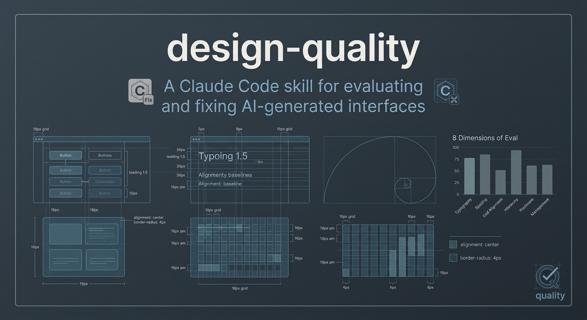
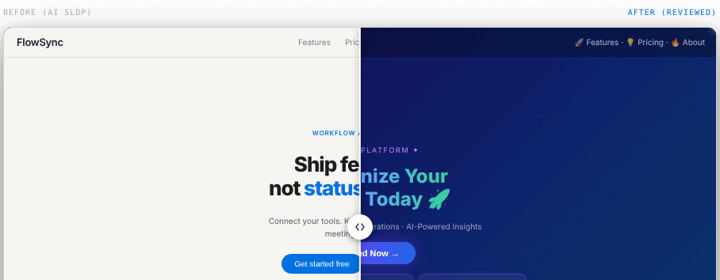

[English](README.md) · **Español** · [Português (Brasil)](README.pt-BR.md) · [简体中文](README.zh-CN.md) · [Français](README.fr.md) · [Deutsch](README.de.md) · [日本語](README.ja.md) · [한국어](README.ko.md)

---

    

**[→ Demo en vivo: romulorogerio.github.io/design-quality](https://romulorogerio.github.io/design-quality)**



## Demo



# design-quality

Una skill de calidad de diseño para asistentes de IA — Claude Code, Cursor, Codex, Copilot o cualquier herramienta que acepte instrucciones en markdown.

La IA genera interfaces rápido. También las genera mal, siempre de la misma forma. Gradientes de púrpura a azul, texto en gradiente, bordes luminosos con color, emojis como íconos, grids de tarjetas sin contenido, tipografía solo con Inter, titulares de héroe enormes en herramientas operacionales. Estas son las señales. Esta skill las detecta, puntúa la interfaz en 8 dimensiones y la corrige paso a paso.

Funciona con React, Tailwind, HTML/CSS, Vue, Svelte, dashboards, apps, landing pages, componentes.

---

## Inicio rápido

### Con Claude Code (CLI)

```bash
# Instalar globalmente
claude skills install https://github.com/RomuloRogerio/design-quality

# O copiar directamente
cp -r skills/design-quality ~/.claude/skills/
```

Luego, en cualquier sesión de Claude Code, la skill se carga automáticamente cuando le pides a Claude que revise, critique o construya una UI.

<details>
<summary>🔍 Ejemplo de output del terminal: Modo Review</summary>

```
$ claude review this design

🤖 [design-quality] Analyzing repository and screenshot context...
✨ Found 4 AI-slop indicators. Evaluating against 8-dimension scorecard.

## Slop Audit
❌ Purple-to-blue gradient background (P1) — App.css line 12
❌ Gradient text with background-clip (P1) — HeroTitle component
❌ Emoji in navigation label "🚀 Launch" (P1) — Navbar.tsx
❌ ALL CAPS tracked section header (P1) — features section

## Template Check
Could this UI belong to any other SaaS product? YES → P1
No World reference, no Signature detail found.

## Scorecard
Product fit:    4/10   generic SaaS applied
Hierarchy:      6/10   primary action visible but competing elements
Clarity:        7/10   labels readable, states missing
Taste:          3/10   templated
Restraint:      2/10   excessive decoration
Density:        6/10   appropriate for content
Craft:          5/10   grid inconsistent in footer
Responsiveness: 7/10   mobile layout works
Overall:        5/10

## Verdict
Best part: clear primary CTA, readable label
Worst part: gradient + gradient text — maximum slop signal
Required fix (P0): none
Quick wins (P1): remove gradient background, strip gradient text, replace emoji icons
```

</details>

### Con cualquier asistente de IA (Cursor, Codex, Copilot, Gemini…)

Pega el contenido del archivo de skill directamente en tu chat, o agrégalo como contexto/system prompt:

```
# En tu chat de IA:
"Usa esta skill para revisar mi UI: [pega el contenido de skills/design-quality/SKILL.md]"

# O referencia el archivo en la configuración del agente:
skills/design-quality/SKILL.md   → Revisión de UI
skills/ant-design.md              → Auditoría Ant Design
skills/system-design.md           → Planificación de arquitectura
skills/all.md                     → Las tres a la vez
```

Las skills son markdown puro — sin dependencia de Claude Code. El plugin (slash commands) es exclusivo de Claude Code.

### Con Claude.ai Projects

Sube `skills/design-quality/SKILL.md` y todos los archivos en `skills/design-quality/references/` como conocimiento del proyecto. Claude aplicará la skill a solicitudes relacionadas con UI.

---

## Ejemplos de uso

**Revisar una UI y puntuar:**
```
revisar este diseño
criticar esta UI
¿parece generado por IA?
quitar lo genérico
```

**Comenzar una nueva UI con dirección de producto primero:**
```
construir un dashboard para una herramienta de monitoreo de flota
diseñar el flujo de onboarding de una app de facturación para freelancers
```

**Aplicar pases de corrección en código existente:**
```
corregir el espaciado y los colores en este componente
ejecutar un pase completo de corrección en App.tsx
```

**Aplicar un kit de marca (manual de identidad visual, tokens JSON, logotipos, aplicaciones):**
```
aquí está nuestro manual de marca, léelo antes de diseñar cualquier pantalla
aplica esta marca a la landing page
¿este dashboard es fiel a la marca?
```

**Auditoría Ant Design:**
```
revisar este panel de administración React contra los estándares Ant Design
verificar si este componente sigue las reglas de tokens Ant Design
```

**Planificación de arquitectura:**
```
diseñar un acortador de URL que soporte 100M solicitudes/día
¿cómo almacenar y servir videos subidos por usuarios a escala?
```

---

## Skills en este repositorio

| Skill | Archivo | Para qué sirve |
|---|---|---|
| **design-quality** | [`skills/design-quality/SKILL.md`](skills/design-quality/SKILL.md) | Revisión general de UI, detección de genérico IA, scorecard 8 dimensiones, modos Brand/Create/Fix/Polish, lectura de kit de marca |
| **ant-design** | [`skills/ant-design.md`](skills/ant-design.md) | Revisión Ant Design v6: tokens, componentes, grid 4px, motion, elevación |
| **system-design** | [`skills/system-design.md`](skills/system-design.md) | Arquitectura escalable: framework 5 pasos, selección de BD, caché, colas, CAP |
| **all** | [`skills/all.md`](skills/all.md) | Carga las tres a la vez; Claude elige la relevante automáticamente |

---

## Plugin (comandos slash de Claude Code)

La carpeta `plugin/` agrega cinco comandos slash y un hint en la barra de estado a cualquier sesión de Claude Code.

| Comando | Qué hace |
|---|---|
| `/dq-review` | Auditoría completa de UI: detección de genérico, scorecard 8 dimensiones, lista de correcciones P0–P3 |
| `/direction` | Modo Create: deriva dirección (Carácter · Mundo · Momentos · Firma) antes de cualquier código de UI |
| `/fix` | Modo Fix: 10 pases secuenciales: Espaciado → Color → Íconos → Copy → Tipografía → Layout → Detalles → A11y → Visuales → Movimiento |
| `/polish` | Modo Polish: recorre cada estado al 10% de velocidad (hover · focus · active · loading · empty · error) |
| `/brand` | Lee un kit de marca (manual de identidad visual, tokens JSON, logotipos, aplicaciones) y genera un `BRAND.md` confirmado |

Después de editar cualquier archivo `.tsx`, `.jsx`, `.css`, `.scss`, `.html`, `.vue` o `.svelte`, la barra de estado muestra `/dq-review · /fix · /polish` como recordatorio.

**Instalar:**
```bash
# Clonar el repositorio
git clone https://github.com/RomuloRogerio/design-quality

# Iniciar Claude Code con el plugin
claude --plugin-dir ~/design-quality/plugin
```

**O cargar permanentemente:** agregar a `~/.claude/settings.json`:
```json
{
  "pluginDirs": ["~/design-quality/plugin"]
}
```

---

## El problema que resuelve

### Cómo se ven las interfaces de IA

Cuando un LLM genera una UI sin restricciones, produce la misma interfaz cada vez. Ha visto miles de screenshots de Dribbble, portafolios y landing pages de SaaS. Optimiza para "impresionante a primera vista" en lugar de "útil en la práctica."

El resultado siempre es reconocible:

**Color:** Fondo con gradiente de púrpura a azul. Texto en gradiente con `background-clip: text`. Bordes luminosos con color. Manchas radiales de color detrás del contenido.

**Tipografía:** Titulares de héroe enormes en herramientas operacionales. Etiquetas en MAYÚSCULAS con tracking en cada sección. Emojis mezclados en etiquetas ("🚀 Lanzar", "Nuevo ✨"). Solo Inter o Roboto sin ninguna otra decisión tipográfica.

**Layout:** Grid de 3 columnas de tarjetas usado como relleno. Todo centrado. Tema oscuro aplicado sin razón de producto. Cada sección con el mismo espaciado.

**Copy:** "Revoluciona Tu Flujo de Trabajo Hoy." "Integraciones poderosas." "Análisis Avanzados." Copy que podría pertenecer a cualquier producto de la categoría.

**Identidad:** Si cambiares el nombre del producto por el de cualquier competidor, la interfaz seguiría encajando. Sin Mundo, sin Firma, sin Momentos: nada que solo este producto tendría.

### Qué hace esta skill de forma diferente

Detecta estos patrones sistemáticamente, puntúa lo que hay y corrige en el orden correcto. También los previene desde el inicio al requerir una dirección de producto antes de escribir cualquier UI.

---

## Modos

### Modo de Marca

Entrada: un kit de marca. Colócalo en una carpeta `brand/` o adjunta los archivos en el chat:

```
brand/
  miv.pdf          manual de identidad visual (PDF o imágenes de páginas)
  tokens.json      tokens de diseño o JSON de marca, en cualquier formato
  logos/           SVG preferido, PNG también aceptado
  applications/    fotos o capturas de la marca aplicada
```

La skill lee el manual página por página, convierte el JSON al formato W3C Design Tokens, hace el inventario de logotipos y estudia las aplicaciones. Escribe un `BRAND.md` con reglas del logo, colores con valores oficiales, fuentes, tono de voz, excepciones de marca y tokens protegidos, y pide tu confirmación.

A partir de ahí, todos los modos trabajan dentro de la marca:
- **Review** añade un agente de fidelidad de marca y una novena puntuación
- **Create** usa la paleta y la tipografía de la marca
- **Fix** nunca cambia un color, fuente o logo de la marca
- Un patrón que el manual documenta, como un gradiente oficial, deja de contar como genérico donde el manual lo permite

El logo es siempre el archivo proporcionado: nunca reconstruido en texto o CSS, nunca recoloreado ni distorsionado.

### Modo de Revisión

Entrada: screenshot, código HTML/CSS, carpeta del proyecto, URL o enlace de artefacto.

Salida:
```
## Auditoría de UI Genérica
[cada hallazgo con ubicación y severidad]

## Verificación de Plantilla
[¿encajaría esto con cualquier producto de la categoría?]

## Tarjeta de Puntuación
Ajuste de producto:   X/10   [nota de una línea]
Jerarquía:            X/10
Claridad:             X/10
Gusto:                X/10
Contención:           X/10
Densidad:             X/10
Craft:                X/10
Responsividad:        X/10
Fidelidad de marca:   X/10   [solo con BRAND.md]
General:              X/10

## Veredicto
Mejor parte:
Peor parte:
Corrección requerida (P0): [si aplica]
Victorias rápidas (P1): [top 3]
```

Escala de severidad:
- **P0:** rompe usabilidad o legibilidad. Corregir antes que cualquier otra cosa.
- **P1:** hace que parezca claramente generado por IA.
- **P2:** debilita el craft pero no lo rompe.
- **P3:** mejora deseable.

### Modo de Creación

Antes de escribir cualquier UI, la skill requiere:
1. **Tipo de contexto:** pantalla de app (la densidad gobierna) vs. página (la composición gobierna)
2. **Comprensión del producto:** qué hace, para quién es, cuál es la tarea principal
3. **Dirección:** cinco líneas derivadas del producto: Producto, Carácter, Mundo, Momentos, Firma
4. **Diales de Diseño:** tres perillas como señal rápida: Varianza / Movimiento / Densidad (1–10 cada una)

Tras la confirmación, crea un `PROJECT_DESIGN.md` en la raíz del proyecto que persiste la dirección entre sesiones. Las sesiones futuras leen este archivo primero: la dirección no se desvía.

Ejemplo de dirección para una herramienta de seguimiento de tiempo:
```
Producto: Seguimiento de tiempo para freelancers que odian rastrear el tiempo.
Carácter: tranquilo, exacto, un poco cálido
Mundo: Relojes, cronómetros, sesiones de enfoque tranquilas
Momentos: La vista semanal donde se acumulan las horas; el momento de generar la factura
Firma: Una animación sutil del segundero en el timer activo
```

### Modo de Corrección

Diez pases secuenciales: completar cada uno antes de empezar el siguiente:

1. **Espaciado:** alineación de cuadrícula de 8px, ritmo, agrupación
2. **Color:** eliminar elementos genéricos, construir desde una rampa neutral
3. **Íconos:** una librería, un tamaño, un peso de trazo, `currentColor`
4. **Copy:** eliminar etiquetas con emojis, calmar los gritos, hacer el copy específico al producto
5. **Tipografía:** jerarquía, pesos, `text-wrap: balance` en títulos
6. **Layout:** alineación, densidad
7. **Detalles:** radios concéntricos, sombras (no sombra Y borde al mismo tiempo), bordes
8. **Accesibilidad y Touch:** estados de foco, `aria-label`, `touch-action: manipulation`, objetivos de 44px
9. **Visuales:** ilustraciones de estados vacíos, consistencia de íconos, relaciones de aspecto de imágenes
10. **Movimiento:** último pase, solo donde agrega significado

### Modo de Pulido

Para interfaces que están mayormente diseñadas pero se sienten ligeramente incorrectas.

Técnica: desacelerar la interfaz al 10% de velocidad en DevTools (panel de Animaciones). Recorrer cada estado: hover, focus, active, loading, empty. Lo que se siente mal al 10% es lo que está mal a velocidad normal.

---

## Dimensiones de la tarjeta de puntuación

| Dimensión | La pregunta que hace |
|---|---|
| **Ajuste de producto** | ¿La dirección visual coincide con el trabajo real y la audiencia del producto? |
| **Jerarquía** | ¿Puede el usuario ver qué importa primero, segundo, tercero? |
| **Claridad** | ¿Son fáciles de entender las etiquetas, acciones, datos y estados? |
| **Gusto** | ¿Se siente intencional sin verse como una plantilla? |
| **Contención** | ¿Sin decoración innecesaria, relleno ni cosplay de estilo? |
| **Densidad** | ¿Es correcta la cantidad de información para la tarea? |
| **Craft** | Espaciado, tipografía, alineación, contraste, estados de componentes: ¿pulidos? |
| **Responsividad** | ¿El diseño sobrevive en mobile y layouts estrechos? |
| **Fidelidad de marca** _(solo con BRAND.md)_ | ¿La UI respeta la identidad visual, los tokens y las reglas de uso de la marca? |

### Qué significa cada puntuación

**Ajuste de producto:**
- 9–10: Solo este producto podría verse así
- 7–8: Claramente alineado con la categoría, algunas elecciones genéricas
- 5–6: Podría pertenecer a varios productos: seguro pero no específico
- 3–4: SaaS genérico aplicado sin importar lo que hace el producto
- 1–2: El diseño contradice activamente al producto

**Jerarquía:**
- 9–10: La acción primaria es obvia, las secundarias retroceden, las terciarias son descubribles
- 5–6: Requiere esfuerzo para analizar: múltiples elementos compitiendo al mismo peso visual
- 1–2: Los elementos decorativos llaman más atención que los funcionales

**Craft:**
- 9–10: Cuadrícula de 8px en todas partes, todos los estados manejados, contraste verificado
- 5–6: Buena intención, ejecución desigual: rupturas de cuadrícula, estados faltantes
- 1–2: Sin cuadrícula o sistema tipográfico discernible

**Responsividad:**
- 9–10: Funciona a 375px / 768px / 1024px / 1440px, mobile es cuidadoso no solo apilado
- 3–4: Roto o apretado en mobile, objetivos táctiles demasiado pequeños
- 1–2: Sin consideración responsiva, inutilizable en mobile

---

## Antipatrones detectados

### Color y Efectos (100+ patrones)

| Patrón | Severidad |
|---|---|
| Gradiente de púrpura a azul en fondo, tarjeta o botón | `P1` |
| Cualquier gradiente de tono a tono en una superficie | `P1` |
| Texto en gradiente (`background-clip: text`) | `P1` |
| Borde luminoso (`box-shadow` con color saturado) | `P1` |
| Mancha de color radial / lavado atmosférico detrás del contenido | `P1` |
| Fondo que se lee como un tono en una pantalla de app | `P1` |
| Sombra con color en tarjetas o botones | `P2` |
| Blur de "glassmorfismo" sin razón de capas significativa | `P2` |

### Tipografía

| Patrón | Severidad |
|---|---|
| Emojis en etiquetas o títulos ("Nuevo ✨", "🚀 Lanzar") | `P1` |
| Etiquetas en MAYÚSCULAS con tracking en cada encabezado de sección | `P1` |
| Titular de héroe enorme en una herramienta operacional funcional | `P1` |
| Copy que grita ("Revoluciona Tu Flujo de Trabajo Hoy") | `P1` |
| Solo Inter sin ninguna otra decisión tipográfica | `P2` |
| Sin diferencia de peso visual entre título y cuerpo | `P1` |

### Layout y Estructura

| Patrón | Severidad |
|---|---|
| Grid de 3 columnas igualmente espaciado usado como relleno de contenido | `P1` |
| Tarjetas de características duplicadas (ícono + título + dos oraciones cada una) | `P1` |
| Dashboard oscuro aplicado por defecto sin razón de producto | `P1` |
| Sección que existe solo para llenar espacio (estadísticas falsas, testimonios inventados) | `P1` |
| Sin jerarquía visual: todos los elementos con el mismo peso | `P1` |
| Todo centrado, sin patrón de lectura alineado a la izquierda | `P2` |

### Íconos

| Patrón | Severidad |
|---|---|
| Emojis usados como íconos en navegación o tarjetas | `P1` |
| Dos o más librerías de íconos mezcladas en una pantalla | `P2` |
| Íconos con sus propios colores (no `currentColor`) | `P2` |
| Íconos decorativos antes de cada título o etiqueta | `P2` |

### Identidad de Plantilla

| Patrón | Severidad |
|---|---|
| Cambiar el nombre del producto por un competidor: la UI sigue encajando | `P1` |
| Sin detalle de Firma: nada que solo este producto tendría | `P1` |
| Sin referencia al Mundo: los neutrales no tienen tinte hacia el dominio del producto | `P2` |
| Ilustración de stock genérica que podría pertenecer a cualquier producto | `P2` |

### Accesibilidad y Técnico

| Patrón | Severidad |
|---|---|
| Contraste de texto por debajo de 4.5:1 (WCAG AA) | `P0` |
| Sin indicador de foco visible en elementos interactivos | `P0` |
| Botón de ícono sin `aria-label` | `P1` |
| Input de formulario sin `<label>` asociado | `P1` |
| `user-scalable=no` en el viewport meta | `P1` |
| `prefers-reduced-motion` no respetado | `P1` |
| `transition: all` en lugar de propiedades específicas | `P2` |
| Etiquetas de gráficos superponiéndose | `P0` |

### Mobile y Touch

| Patrón | Severidad |
|---|---|
| Objetivos táctiles menores de 44×44px | `P1` |
| Efectos hover sin guardia `@media (hover: hover)` | `P2` |
| `touch-action: manipulation` faltante en botones | `P2` |
| `overscroll-behavior: contain` faltante en modals | `P2` |

---

## Marco de dirección

Las cinco líneas que todo diseño necesita antes de escribir código:

**Producto:** qué hace y para quién, una oración simple.

**Carácter:** 2–3 palabras concretas. `tranquilo, exacto, un poco cálido` o `rápido, técnico, juguetón`.
Prohibidas: limpio, moderno, elegante, minimal, premium. Estas describen cada plantilla.

**Mundo:** el material o lugar al que el producto pertenece naturalmente.
- App de notas → papel y tinta
- Herramienta de monitoreo → instrumentos y turnos nocturnos
- App de viajes → mapas y luz de ventana
- Herramienta financiera → libros contables, columnas limpias, autoridad tranquila

Esto tinta los neutrales, el acento y los momentos visuales.

**Momentos:** 1–2 lugares en la pantalla donde el diseño se vuelve rico y específico.
Todo lo demás se mantiene tranquilo para que estos se lean instantáneamente.

**Firma:** un pequeño detalle que solo este producto tendría, repetido consistentemente.
- Herramienta de monitoreo → punto de estado en vivo
- Herramienta de desarrollador → estética de keycap
- App de entregas → línea de ruta

Un detalle, no cinco.

### Diales de Diseño

Tres perillas mostradas para cada propuesta de dirección:

```
Varianza  ░░░░░░░░░░  1–10   (1 = centrado/minimal, 10 = audaz/asimétrico)
Movimiento ░░░░░░░░░░  1–10   (1 = estático, 10 = animado)
Densidad  ░░░░░░░░░░  1–10   (1 = espacioso/editorial, 10 = dashboard/denso)
```

### PROJECT_DESIGN.md

Tras confirmar la dirección, la skill crea este archivo en la raíz del proyecto:

```markdown
# PROJECT_DESIGN.md

## Dirección: [Nombre]
Producto: [una oración]
Carácter: [2–3 palabras]
Mundo: [material / lugar]
Momentos: [1–2 lugares específicos]
Firma: [un detalle]

## Diales
Varianza: X/10
Movimiento: X/10
Densidad: X/10

## Paleta
Canvas: [token + hex]
Acento: [token + hex]
Texto principal: [token + hex]
Texto suavizado: [token + hex]

## Tipografía
Display: [nombre de fuente + peso]
Cuerpo: [nombre de fuente + peso]
Mono: [nombre de fuente] (si aplica)

## Radio de borde: [valor]px
```

Las sesiones futuras leen esto primero. La dirección no se desvía en proyectos largos.

---

## Principios de diseño aplicados

### Fundamentos Teóricos y Psicología del Diseño

Esta skill evalúa interfaces basándose en psicología del comportamiento y marcos de diseño clásicos, no en estéticas pasajeras:

- **La Regla Pico-Final (Daniel Kahneman):** Los usuarios juzgan las experiencias por sus momentos pico y final: no por el promedio. Por eso la skill presta especial atención a la interacción más intensa y a la pantalla final de cada flujo.
- **Marco de Diseño Emocional (Don Norman):** Las interfaces deben abordar tres niveles simultáneamente: visceral (primera impresión), conductual (facilidad de uso) y reflexivo (significado e identidad). Una puntuación inferior a 7 en Product Fit suele indicar falla en el nivel reflexivo.
- **Affordances (James J. Gibson / Don Norman):** Los elementos interactivos deben comunicar su función claramente sin requerir exploración. Los estados de foco ausentes, los botones de ícono sin etiqueta y los objetivos táctiles invisibles violan este principio.

---

### Espaciado
- Cuadrícula de 8px. Todos los márgenes, paddings, gaps son múltiplos de 4 u 8.
- `mt-[13px]` siempre es incorrecto. Corregirlo.
- El espacio muestra agrupación: gap interno < gap externo. Una etiqueta de sección está más cerca de sus propios elementos que de la sección anterior.

### Color
- Una rampa neutral, teñida hacia el Mundo.
- Un acento, usado raramente: acción primaria, selección, el único número que importa.
- Tres roles de texto: primario, secundario, suavizado. Nunca diez grises ligeramente diferentes.
- Preferir OKLCH para nuevos tokens de color: `oklch(L% C H)`: perceptualmente uniforme, más fácil de ajustar.
- Prohibidos: gradientes de tono en superficies, texto en gradiente, brillos de color, manchas radiales, bordes de neón.

### Tipografía
- Combinar una fuente de display distintiva con una fuente de cuerpo limpia. Maximizar el contraste de peso.
- `text-wrap: balance` en todos los títulos. `text-wrap: pretty` en texto de cuerpo.
- `-webkit-font-smoothing: antialiased` en `:root` (macOS renderiza más nítido).
- Texto de cuerpo mínimo de 14px (preferir 16px). Un h1 por página.

### Componentes
- Botones: etiquetas con verbo primero. Un primario por sección.
- Sin emojis como íconos. Una librería de íconos, un peso de trazo, solo `currentColor`.
- Tarjetas: sombra O borde, no ambos.
- Estados vacíos: ilustración + titular + CTA. Nunca solo vacío.
- Loading: pantallas de skeleton (no spinners) después de 300ms de retraso.

### Regla del Único Elemento Brillante
Cada pantalla obtiene un elemento pulido y rico. Todo lo demás se mantiene tranquilo.
El chrome (navegación, botones, fondos) nunca compite con el contenido.

---

## Lista de verificación de pulido

Antes de marcar cualquier UI como terminada:

- [ ] Sin emojis como íconos (usar SVG: Heroicons / Lucide / Phosphor / Radix)
- [ ] `cursor-pointer` en todos los elementos clicables
- [ ] Contraste de texto ≥ 4.5:1 (WCAG AA)
- [ ] Estados de foco visibles para navegación por teclado (`focus-visible`, no `outline` eliminado)
- [ ] `aria-label` en cada botón de ícono
- [ ] `<label>` asociado a cada input de formulario
- [ ] `prefers-reduced-motion` respetado
- [ ] `touch-action: manipulation` en botones
- [ ] Estados hover usan `@media (hover: hover) and (pointer: fine)`
- [ ] Texto, chips y badges se reorganizan en anchos estrechos sin cortarse
- [ ] Responsivo a 375px, 768px, 1024px, 1440px
- [ ] Sin hallazgos P0 del Modo de Revisión
- [ ] Estados vacío, loading y error todos manejados
- [ ] Números dinámicos usan `font-variant-numeric: tabular-nums`
- [ ] Los títulos tienen `text-wrap: balance`
- [ ] Sin `transition: all` en ningún lado

---

## Verificación del Estado Emocional

Una verificación que la skill ejecuta durante el Modo de Revisión. Pregunta qué está sintiendo el usuario en cada estado clave, luego verifica si la interfaz reconoce esos sentimientos.

Loading: ¿ansioso? ¿esperando?
Estado vacío: ¿perdido? ¿primera vez?
Error: ¿avergonzado?

Señalar cuando:
- El copy de loading es "Cargando..." → P2 (debería ser "Obteniendo tus datos" o similar)
- El mensaje de error culpa al usuario por un fallo del sistema → P1
- El estado vacío no ofrece nada: sin instrucción, sin CTA → P1
- El éxito se absorbe en silencio (sin reconocimiento) → P2

---

## Regla Pico-Final

Para flujos de múltiples pasos, la skill mapea los dos momentos que dominan cómo se recuerda el flujo:

- **Pico**: el momento emocionalmente más intenso (pedido realizado, formulario enviado, primer resultado). ¿Está bien diseñado?
- **Final**: la pantalla/estado final. ¿Confirma claramente y llega de forma cálida?

Terminar en una pantalla administrativa, una página de estado confusa o un error sin resolver → P1.

---

## Valores de micro-pulido

### Radio de borde concéntrico

Radio del elemento externo = radio del elemento interno + el padding entre ellos.

```css
/* Incorrecto */
.card { border-radius: 12px; padding: 16px; }
.card-inner { border-radius: 12px; } /* demasiado pequeño — las esquinas internas son planas */

/* Correcto */
.card { border-radius: 24px; padding: 12px; }
.card-inner { border-radius: 12px; } /* 24 - 12 = 12 ✓ */
```

### Animación de pulsación

```css
button {
  transition: transform 150ms ease-out;
}
button:active {
  transform: scale(0.96);
}
```

Siempre 0.96: nunca menor que 0.95.

### Transiciones

```css
/* Nunca */
transition: all 200ms ease;

/* Siempre especificar */
transition: transform 200ms ease-out, opacity 200ms ease-out;
```

### Objetivos táctiles

```css
/* Botón de ícono pequeño con área de golpe extendida */
.icon-button {
  width: 20px;
  height: 20px;
  position: relative;
}
.icon-button::before {
  content: '';
  position: absolute;
  inset: -12px; /* extiende el área de golpe a 44×44 sin cambiar el layout */
}
```

---

## Principios de movimiento

El movimiento es un presupuesto. Preguntarse por cada animación: ¿eliminarla hace la interfaz peor, o solo menos llamativa? Si la respuesta es "solo menos llamativa," eliminarla.

**Interacciones de alta frecuencia (usadas >10×/día): sin animación personalizada.**
Hover de fila, feedback de tecla, cambio de tab, toggle: respuesta instantánea o transición mínima a ≤150ms.

**Acciones de baja frecuencia (usadas raramente o por primera vez): ganarse la animación.**
Pasos de onboarding, estado vacío → primer elemento, estados de éxito: 150–300ms con ease-out simple.

**Transiciones CSS sobre keyframes para elementos interactivos.**
Las transiciones son interrumpibles. Si un usuario abre un drawer y lo cierra a mitad de la animación, una transición se revierte suavemente. Una animación keyframe se reinicia desde el principio.

---

## Estructura del repositorio

```
design-quality/
├── README.md (+ 7 traducciones)
├── CHANGELOG.md
├── CONTRIBUTING.md
├── LICENSE
├── plugin/                     ← comandos slash de Claude Code
│   ├── .claude-plugin/
│   └── hooks/
└── skills/
    ├── all.md                  ← cargar las tres skills a la vez
    ├── ant-design.md           ← Ant Design v6 — revisión y corrección
    ├── system-design.md        ← planificación de arquitectura escalable
    └── design-quality/
        ├── SKILL.md
        └── references/
```

**Navegación rápida:**

| Archivo | Descripción |
|---|---|
| [README.md](README.md) | Este archivo (+ [es](README.es.md) · [pt-BR](README.pt-BR.md) · [zh-CN](README.zh-CN.md) · [fr](README.fr.md) · [de](README.de.md) · [ja](README.ja.md) · [ko](README.ko.md)) |
| [CHANGELOG.md](CHANGELOG.md) | Historial de versiones |
| [CONTRIBUTING.md](CONTRIBUTING.md) | Cómo contribuir |
| [LICENSE](LICENSE) | Licencia MIT |
| **Skills** | |
| [skills/all.md](skills/all.md) | Cargar las tres skills a la vez |
| [skills/design-quality/SKILL.md](skills/design-quality/SKILL.md) | Revisión de UI, detección de genérico, scorecard, Create/Fix/Polish |
| [skills/ant-design.md](skills/ant-design.md) | Revisión de tokens/componentes Ant Design v6 |
| [skills/system-design.md](skills/system-design.md) | Planificación de arquitectura escalable |
| **Plugin** | |
| [plugin/hooks/register.ts](plugin/hooks/register.ts) | Código fuente de hooks de comandos slash |
| [plugin/README.md](plugin/README.md) | Instrucciones de instalación del plugin |
| **Referencias** | |
| [slop-signs.md](skills/design-quality/references/slop-signs.md) | Catálogo completo de anti-patrones |
| [quality-dimensions.md](skills/design-quality/references/quality-dimensions.md) | Detalles de las dimensiones del scorecard |
| [micro-polish.md](skills/design-quality/references/micro-polish.md) | Referencia de micro-polish |
| [passes-visuals.md](skills/design-quality/references/passes-visuals.md) | Passes de corrección visual |
| [passes-motion.md](skills/design-quality/references/passes-motion.md) | Passes de corrección de movimiento |
| [review-guide.md](docs/review-guide.md) | Guía del modo de revisión |
| [fix-mode-walkthrough.md](docs/fix-mode-walkthrough.md) | Guía del modo de corrección |
| [slop-field-guide.md](docs/slop-field-guide.md) | Guía de campo de genérico IA |

---

## Contribuir

Ver [CONTRIBUTING.md](CONTRIBUTING.md) para cómo agregar señales de IA genérica, proponer nuevas dimensiones o contribuir traducciones.

---

## Relacionado

- [designer-skills](https://github.com/Owl-Listener/designer-skills): 111 skills de diseño especializadas que esta skill referencia para análisis profundos
- [impeccable](https://github.com/pbakaus/impeccable): estándares de diseño para interfaces generadas por IA

---

## Licencia

MIT: ver [LICENSE](LICENSE).
