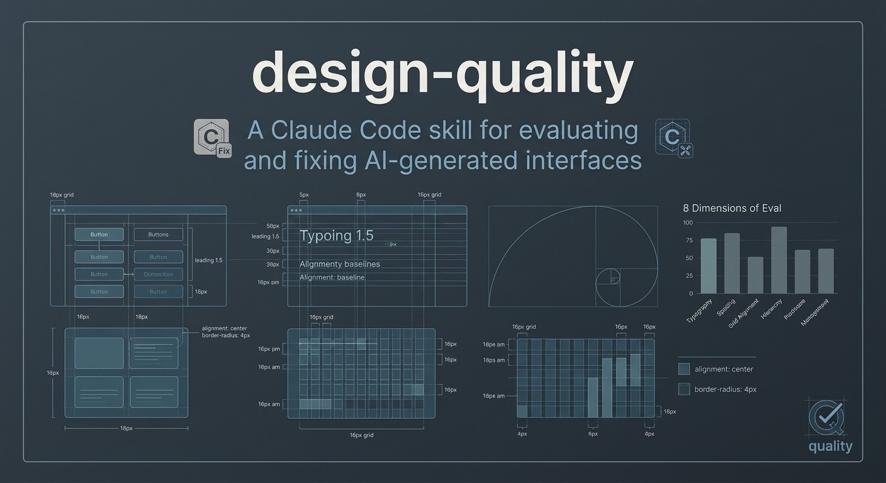
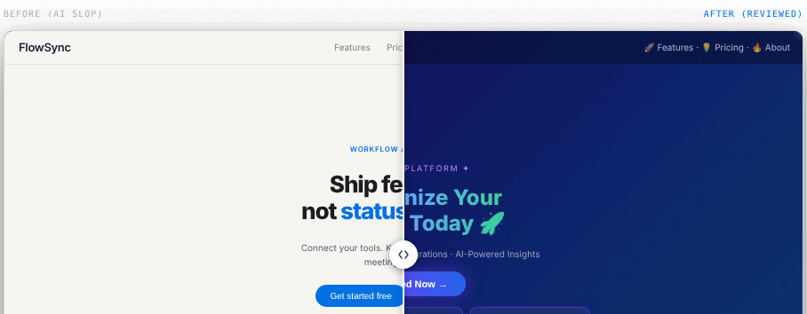

[English](README.md) · [Español](README.es.md) · [Português (Brasil)](README.pt-BR.md) · [简体中文](README.zh-CN.md) · [Français](README.fr.md) · [Deutsch](README.de.md) · **日本語** · [한국어](README.ko.md)

---

    

**[→ ライブデモ: romulorogerio.github.io/design-quality](https://romulorogerio.github.io/design-quality)**



## Demo



# design-quality

AIコーディングアシスタント向けデザイン品質スキル — Claude Code、Cursor、Codex、Copilot、またはMarkdown指示を受け入れるあらゆるツールで使用可能。

AIはUIを素早く生成します。しかし、いつも同じ方法で間違えます。紫から青へのグラデーション、グラデーションテキスト、光るボーダー、絵文字アイコン、内容のないカードグリッド、Inter一辺倒のタイポグラフィ、業務ツールの過大なヒーロー見出し。これらが特徴です。このスキルはそれらを検出し、8つの次元でインターフェースをスコアリングし、一歩ずつ修正します。

React、Tailwind、HTML/CSS、Vue、Svelte、ダッシュボード、アプリ、ランディングページ、コンポーネントに対応。


---

## クイックスタート

### Claude Code（CLI）で使用

```bash
# グローバルインストール
claude skills install https://github.com/RomuloRogerio/design-quality

# またはそのまま直接コピー
cp -r skills/design-quality ~/.claude/skills/
```

これ以降、Claude Codeのセッションで UIのレビュー、批評、または構築を依頼すると、スキルが自動的にロードされます。

<details>
<summary>🔍 ターミナル出力例: Review モード</summary>

```
$ claude review this design

🤖 [design-quality] Analyzing repository and screenshot context...
✨ Found 4 AI-slop indicators. Evaluating against 8-dimension scorecard.

## Slop Audit
❌ Purple-to-blue gradient background (P1) — App.css line 12
❌ Gradient text with background-clip (P1) — HeroTitle component
❌ Emoji in navigation label "🚀 Launch" (P1) — Navbar.tsx
❌ ALL CAPS tracked section header (P1) — features section

## Template Check
Could this UI belong to any other SaaS product? YES → P1
No World reference, no Signature detail found.

## Scorecard
Product fit:    4/10   generic SaaS applied
Hierarchy:      6/10   primary action visible but competing elements
Clarity:        7/10   labels readable, states missing
Taste:          3/10   templated
Restraint:      2/10   excessive decoration
Density:        6/10   appropriate for content
Craft:          5/10   grid inconsistent in footer
Responsiveness: 7/10   mobile layout works
Overall:        5/10

## Verdict
Best part: clear primary CTA, readable label
Worst part: gradient + gradient text — maximum slop signal
Required fix (P0): none
Quick wins (P1): remove gradient background, strip gradient text, replace emoji icons
```

</details>

### あらゆるAIアシスタントで使用（Cursor、Codex、Copilot、Geminiなど）

スキルファイルの内容をチャットに直接貼り付けるか、コンテキスト/システムプロンプトとして追加してください：

```
# AIチャットで：
「このスキルを使ってUIをレビューして：[skills/design-quality/SKILL.mdの内容を貼り付け]」

# またはエージェント設定でファイルを参照：
skills/design-quality/SKILL.md   → UIレビュー
skills/ant-design.md              → Ant Design監査
skills/system-design.md           → アーキテクチャ設計
skills/all.md                     → 3つすべて同時に
```

スキルはプレーンMarkdown — Claude Codeへの依存なし。プラグイン（スラッシュコマンド）はClaude Code専用。

### Claude.ai プロジェクトで使用

`skills/design-quality/SKILL.md` と `skills/design-quality/references/` 内の全ファイルをプロジェクトのナレッジとしてアップロードします。ClaudeはUI関連のリクエストにスキルを適用します。

---

## 使用例

**UIを見直してスコアリングする：**
```
このデザインをレビューして
このUIを批評して
AIが作ったように見える？
AI臭を消して
```

**プロダクト方向性を決めてから新しいUIを始める：**
```
フリート監視ツールのダッシュボードを作って
フリーランサー向け請求書アプリのオンボーディングフローをデザインして
```

**既存コードに修正パスを適用する：**
```
このコンポーネントのスペーシングと色を修正して
App.tsxに完全な修正パスを実行して
```

**ブランドキットを適用する（MIV・ブランドブック、トークンJSON、ロゴ、適用例）：**
```
ブランドマニュアルを渡すのでデザイン前に読んで
このランディングページにブランドを適用して
このダッシュボードはブランドガイドラインに沿っている？
```

**Ant Designの監査：**
```
Ant Designの標準に照らしてこのReact管理パネルを見直して
このコンポーネントがAnt DesignのTokenルールに従っているか確認して
```

**アーキテクチャ設計：**
```
1日1億リクエストをサポートするURLショートナーを設計して
スケールでユーザーがアップロードした動画を保存・配信するにはどうすればいい？
```

---

## このリポジトリのスキル

| スキル | ファイル | 用途 |
|---|---|---|
| **design-quality** | [`skills/design-quality/SKILL.md`](skills/design-quality/SKILL.md) | 汎用 UI レビュー、AI スロップ検出、8次元スコアカード、Brand/Create/Fix/Polish モード、ブランドキット読み込み |
| **ant-design** | [`skills/ant-design.md`](skills/ant-design.md) | Ant Design v6 レビュー: トークン、コンポーネント、4px グリッド、モーション、エレベーション |
| **system-design** | [`skills/system-design.md`](skills/system-design.md) | スケーラブルなアーキテクチャ: 5ステップフレームワーク、DB選定、キャッシュ、キュー、CAP |
| **all** | [`skills/all.md`](skills/all.md) | 3つすべてを一度に読み込む；Claude が自動的に適切なものを選択 |

---

## プラグイン（Claude Code スラッシュコマンド）

`plugin/` フォルダは、任意の Claude Code セッションに5つのスラッシュコマンドとステータスバーヒントを追加します。

| コマンド | 機能 |
|---|---|
| `/dq-review` | 完全な UI 監査：スロップ検出、8次元スコアカード、P0–P3 修正リスト |
| `/direction` | Create モード: UI コードを書く前に方向を導出（キャラクター · 世界 · モーメント · シグネチャー） |
| `/fix` | Fix モード: 10の順次パス：間隔 → カラー → アイコン → コピー → タイポグラフィ → レイアウト → 詳細 → A11y → ビジュアル → モーション |
| `/polish` | Polish モード: 10% 速度で各状態を走査（hover · focus · active · loading · empty · error） |
| `/brand` | ブランドキット（MIV・ブランドブック、トークンJSON、ロゴ、適用例）を読み込み、確認済み `BRAND.md` を生成 |

`.tsx`、`.jsx`、`.css`、`.scss`、`.html`、`.vue`、または `.svelte` ファイルを編集すると、ステータスバーに `/dq-review · /fix · /polish` が表示されます。

**インストール：**
```bash
# リポジトリをクローン
git clone https://github.com/RomuloRogerio/design-quality

# プラグインで Claude Code を起動
claude --plugin-dir ~/design-quality/plugin
```

**または永続的に読み込む:** `~/.claude/settings.json` に追加：
```json
{
  "pluginDirs": ["~/design-quality/plugin"]
}
```

---

## 解決する問題

### AIのUIが持つ外観

LLMが制約なしにUIを生成すると、毎回同じインターフェースを作ります。何千ものDribbbleのショット、ポートフォリオ、SaaSランディングページを見てきたLLMは、"実際に使いやすい"よりも"一瞬見て印象的"に最適化します。

結果は常に見覚えがあります：

**カラー：** 紫から青へのグラデーション背景。`background-clip: text`を使ったグラデーションテキスト。彩色した光るボーダー。コンテンツの後ろの放射状カラーブロブ。

**タイポグラフィ：** 業務ツールでの過大なヒーロー見出し。全セクションに追跡カーニングのALLCAPSラベル。ラベルに混じった絵文字（"🚀 起動"、"新機能 ✨"）。他のタイポグラフィ判断なしにInterまたはRobotoのみ。

**レイアウト：** コンテンツの穴埋めに使われる3カラムカードグリッド。全て中央揃え。製品上の理由なしに適用されたダークテーマ。全セクション同じスペーシング。

**コピー：** "今すぐワークフローを革命しよう。" "パワフルなインテグレーション。" "高度なアナリティクス。" カテゴリのどの製品にも当てはまるコピー。

**アイデンティティ：** 製品名をどの競合他社に変えても、インターフェースは合い続ける。ワールド、シグネチャー、モーメント: この製品だけが持つものが何もない。

### このスキルの違い

これらのパターンを系統的に検出し、存在するものをスコアリングし、正しい順序で修正します。UIを書く前に製品の方向性を要求することで、最初から問題を防ぎます。

---

## モード

### ブランドモード

入力：ブランドキット。`brand/` フォルダに配置するか、チャットにファイルを添付：

```
brand/
  miv.pdf          ブランドアイデンティティマニュアル（PDFまたはページ画像）
  tokens.json      デザイントークンまたはブランドJSON、任意の形式
  logos/           SVG推奨、PNG可
  applications/    ブランドを適用した写真やスクリーンショット
```

スキルはマニュアルをページごとに読み込み、JSONをW3Cデザイントークン形式に変換し、ロゴをリストアップし、適用例を分析します。ロゴルール・公式カラー値・フォント・トーン・ブランド例外・保護トークンを含む `BRAND.md` を作成し、確認を求めます。

確認後、すべてのモードがブランド内で動作します：
- **Review** はブランド忠実度エージェントと9番目のスコアを追加
- **Create** はブランドのパレットとタイポグラフィを使用
- **Fix** はブランドのカラー・フォント・ロゴを変更しない
- マニュアルが認めるパターン（公式グラデーションなど）は、許可された文脈ではスロップとみなされない

ロゴは常に提供されたファイルを使用：テキストやCSSで再構築せず、色変更や変形もしない。

### レビューモード

入力：スクリーンショット、HTML/CSSソース、プロジェクトフォルダ、URL、またはアーティファクトリンク。

出力：
```
## スロップ監査
[各発見事項と場所・深刻度]

## テンプレートチェック
[これはカテゴリのどの製品にも当てはまるか？]

## スコアカード
製品適合:            X/10   [1行コメント]
ヒエラルキー:        X/10
明確さ:              X/10
テイスト:            X/10
抑制:                X/10
情報密度:            X/10
クラフト:            X/10
レスポンシブ:        X/10
ブランド忠実度:      X/10   [BRAND.mdがある場合のみ]
総合:                X/10

## 評決
ベスト部分:
ワースト部分:
必須修正（P0）: [あれば]
クイックウィン（P1）: [上位3件]
```

深刻度スケール：
- **P0:** 使いやすさや可読性を破壊。他の全てより先に修正。
- **P1:** 明らかにAI生成に見える。
- **P2:** クラフトを弱めるが破壊はしない。
- **P3:** あると良い改善。

### 作成モード

UIを書く前に、スキルが要求するもの：
1. **コンテキストタイプ:** アプリ画面（密度が主導）vs. ページ（構成が主導）
2. **製品理解:** 何をするか、誰のため、主要タスクは何か
3. **方向性:** 製品から導出された5つの軸：製品、キャラクター、世界観、モーメント、シグネチャー
4. **デザインダイアル:** クイックシグナルとしての3つのノブ：バリアンス / モーション / デンシティ（各1–10）

確認後、方向性をセッション間で持続させる `PROJECT_DESIGN.md` をプロジェクトルートに作成します。以降のセッションはこのファイルを最初に読みます: 方向性がドリフトしません。

時間追跡ツールの方向性例：
```
製品: 時間追跡が嫌いなフリーランサーのための時間追跡ツール。
キャラクター: 落ち着いた、正確、少し温かみのある
世界観: 時計、タイマー、静かな集中セッション
モーメント: 時間が積み上がるウィークビュー；請求書生成の瞬間
シグネチャー: アクティブなタイマーの秒針の繊細なアニメーション
```

### 修正モード

10の連続パス: 次を始める前に各パスを完了：

1. **スペーシング:** 8pxグリッド整列、リズム、グルーピング
2. **カラー:** スロップを除去し、中立色ランプから構築
3. **アイコン:** 1ライブラリ、1サイズ、1ストローク幅、`currentColor`
4. **コピー:** 絵文字ラベルを削除、叫び声を静め、コピーを製品固有に
5. **タイポグラフィ:** ヒエラルキー、ウェイト、見出しに `text-wrap: balance`
6. **レイアウト:** 整列、密度
7. **ディテール:** 同心円ラジウス、シャドウ（シャドウとボーダーを同時に使わない）、ボーダー
8. **アクセシビリティとタッチ:** フォーカス状態、`aria-label`、`touch-action: manipulation`、44pxターゲット
9. **ビジュアル:** 空ステートイラスト、アイコン一貫性、画像アスペクト比
10. **モーション:** 最後のパス、意味が加わる場所のみ

### ポリッシュモード

ほぼ設計完了だが微妙に違和感のあるインターフェース向け。

テクニック：DevTools（アニメーションパネル）でインターフェースを10%速度に落とす。全ステートを確認：hover、focus、active、loading、empty。10%で違和感を感じるものは、フルスピードでも間違っている。

---

## スコアカードの次元

| 次元 | 問う質問 |
|---|---|
| **製品適合** | ビジュアル方向は製品の実際の仕事とオーディエンスに合っているか？ |
| **ヒエラルキー** | ユーザーは何が1番目、2番目、3番目に重要か見られるか？ |
| **明確さ** | ラベル、アクション、データ、ステートは理解しやすいか？ |
| **テイスト** | テンプレートに見えずに意図的に感じるか？ |
| **抑制** | 不必要な装飾、穴埋め、スタイルコスプレはないか？ |
| **情報密度** | タスクに対して情報量は適切か？ |
| **クラフト** | スペーシング、タイポグラフィ、整列、コントラスト、コンポーネントステート: 磨かれているか？ |
| **レスポンシブ** | デザインはモバイルや狭いレイアウトで耐えられるか？ |
| **ブランド忠実度** _(BRAND.mdがある場合のみ)_ | UIはブランドのビジュアルアイデンティティ、トークン、使用ルールに一致しているか？ |

---

## 検出されるアンチパターン

### カラーと効果（100+パターン）

| パターン | 深刻度 |
|---|---|
| 背景、カード、ボタンへの紫から青へのグラデーション | `P1` |
| サーフェスへのあらゆる色相グラデーション | `P1` |
| グラデーションテキスト（`background-clip: text`） | `P1` |
| 光るボーダー（彩色した`box-shadow`） | `P1` |
| コンテンツの後ろの放射状カラーブロブ / アトモスフィアウォッシュ | `P1` |
| アプリ画面で色相として読まれる背景 | `P1` |
| カードやボタンへの彩色シャドウ | `P2` |
| 意味のあるレイヤリング理由のない「グラスモーフィズム」ブラー | `P2` |

### タイポグラフィ

| パターン | 深刻度 |
|---|---|
| ラベルや見出しの絵文字（"新機能 ✨"、"🚀 起動"） | `P1` |
| 全セクションヘッダーのトラッキングつきALLCAPSラベル | `P1` |
| 機能業務ツールへの過大なヒーロー見出し | `P1` |
| 叫び声コピー（"今すぐワークフローを革命しよう"） | `P1` |
| 他のタイポグラフィ判断なしにInterのみ | `P2` |
| 見出しとボディのビジュアルウェイト差なし | `P1` |

### レイアウトと構造

| パターン | 深刻度 |
|---|---|
| コンテンツ穴埋めに使われる均等スペースの3カラムカードグリッド | `P1` |
| 重複したフィーチャーカード（アイコン+見出し+2文ずつ） | `P1` |
| 製品上の理由なしにデフォルト適用されたダークダッシュボード | `P1` |
| スペースを埋めるためだけに存在するセクション（偽の統計、作り話のお客様の声） | `P1` |
| ビジュアルヒエラルキーなし: 全要素が同じウェイト | `P1` |
| 全て中央揃え、左揃えの読み取りパターンなし | `P2` |

### アイコン

| パターン | 深刻度 |
|---|---|
| ナビゲーションやカードでアイコンとして使われる絵文字 | `P1` |
| 1つの画面に2つ以上のアイコンライブラリを混在 | `P2` |
| 独自の色を持つアイコン（`currentColor`でない） | `P2` |
| 全ての見出しやラベルの前の装飾アイコン | `P2` |

### テンプレートアイデンティティ

| パターン | 深刻度 |
|---|---|
| 製品名を競合他社に変えてもUIが合い続ける | `P1` |
| シグネチャー詳細なし: この製品だけが持つものが何もない | `P1` |
| ワールド参照なし: 中立色が製品ドメインに向いたティントなし | `P2` |
| どの製品にも当てはまる汎用ストックイラスト | `P2` |

### アクセシビリティと技術

| パターン | 深刻度 |
|---|---|
| テキストコントラストが4.5:1未満（WCAG AA） | `P0` |
| インタラクティブ要素に可視フォーカスインジケータなし | `P0` |
| `aria-label`のないアイコンボタン | `P1` |
| 関連付けられた`<label>`のないフォーム入力 | `P1` |
| ビューポートメタの`user-scalable=no` | `P1` |
| `prefers-reduced-motion`が尊重されていない | `P1` |
| 特定プロパティではなく`transition: all` | `P2` |
| 重なるチャートラベル | `P0` |

### モバイルとタッチ

| パターン | 深刻度 |
|---|---|
| 44×44px未満のタッチターゲット | `P1` |
| `@media (hover: hover)`ガードなしのホバーエフェクト | `P2` |
| ボタンに`touch-action: manipulation`がない | `P2` |
| モーダルに`overscroll-behavior: contain`がない | `P2` |

---

## 方向性フレームワーク

コードを書く前に全てのデザインに必要な5つの軸：

**製品:** 何をするか、誰のため、1文で。

**キャラクター:** 2–3の具体的な言葉。`落ち着いた、正確、少し温かみのある` または `速い、技術的、遊び心のある`。
禁止：クリーン、モダン、スリーク、ミニマル、プレミアム。これらは全テンプレートを説明する言葉です。

**世界観:** 製品が自然に属するマテリアルや場所。
- メモアプリ → 紙とインク
- 監視ツール → 計器と夜勤
- 旅行アプリ → 地図と窓の光
- 金融ツール → 台帳、清潔なカラム、静かな権威

これが中立色、アクセント、ビジュアルモーメントにティントを加えます。

**モーメント:** デザインが豊かで具体的になる画面上の1–2カ所。
他は全て静かに保って、これらが即座に読まれるようにします。

**シグネチャー:** この製品だけが持つ一つの小さなディテール、一貫して繰り返される。
- 監視ツール → ライブステータスドット
- 開発者ツール → キーキャップ美学
- 配達アプリ → ルートライン

一つのディテール、五つではなく。

### デザインダイアル

各方向性提案で表示される3つのノブ：

```
バリアンス  ░░░░░░░░░░  1–10   （1 = 中央揃え/ミニマル、10 = 大胆/非対称）
モーション  ░░░░░░░░░░  1–10   （1 = 静的、10 = アニメーション豊富）
デンシティ  ░░░░░░░░░░  1–10   （1 = 余白多め/エディトリアル、10 = ダッシュボード/高密度）
```

---

## 適用されるデザイン原則

### 理論的基盤とデザイン心理学

このスキルは、一時的な美学ではなく、確固たる行動心理学と古典的なデザインフレームワークに基づいてインターフェースを評価します：

- **ピーク・エンドの法則（Daniel Kahneman）：** ユーザーは体験を平均ではなく、ピーク時と終了時で判断します。そのためこのスキルは、各フローで最も強烈なインタラクションと最後の画面に特別な注意を払います。
- **感情的デザインフレームワーク（Don Norman）：** インターフェースは3つのレベルを同時に対処しなければなりません——本能的（第一印象）、行動的（使いやすさ）、内省的（意味とアイデンティティ）。Product Fitが7未満のスコアは、内省的レベルでの失敗を示すことが多いです。
- **アフォーダンス（James J. Gibson / Don Norman）：** インタラクティブ要素は、探索を必要とせずに機能を明確に伝えなければなりません。フォーカス状態の欠如、ラベルなしのアイコンボタン、見えないタッチターゲットはすべてこの原則に違反します。

---

### スペーシング
- 8pxグリッド。全マージン、パディング、ギャップは4または8の倍数。
- `mt-[13px]`は常に間違い。修正する。
- スペースはグルーピングを示す：内部ギャップ < 外部ギャップ。

### カラー
- 一つの中立色ランプ、世界観に向けてティント。
- 一つのアクセント、使用は控えめに：プライマリアクション、選択、重要な1つの数字。
- 3つのテキストロール：プライマリ、セカンダリ、ミュート。10種類のわずかに異なるグレーは不要。
- 新しいカラートークンにはOKLCHを優先：`oklch(L% C H)`: 知覚的に均一で調整しやすい。
- 禁止：サーフェスへの色相グラデーション、グラデーションテキスト、彩色グロー、放射状ブロブ、ネオンボーダー。

### タイポグラフィ
- 特徴的なディスプレイフォントとクリーンなボディフォントをペアリング。ウェイトコントラストを最大化。
- 全見出しに `text-wrap: balance`。ボディテキストに `text-wrap: pretty`。
- `:root` に `-webkit-font-smoothing: antialiased`（macOSでよりクリスプにレンダリング）。
- ボディテキスト最小14px（16px推奨）。1ページに1つのh1。

### コンポーネント
- ボタン：動詞ファーストのラベル。1セクションに1プライマリ。
- アイコンに絵文字を使わない。1アイコンライブラリ、1ストローク幅、`currentColor`のみ。
- カード：シャドウまたはボーダー、両方はNG。
- 空ステート：イラスト + 見出し + CTA。空だけはNG。
- ローディング：300ms遅延後にスケルトンスクリーン（スピナーではなく）。

### ブライトエレメント一つのルール
各画面に一つの磨かれた豊かな要素。他は全て静かに保つ。
クローム（ナビゲーション、ボタン、背景）はコンテンツと競わない。

---

## ポリッシュチェックリスト

UIを完了とマークする前に：

- [ ] アイコンに絵文字を使わない（SVGを使用：Heroicons / Lucide / Phosphor / Radix）
- [ ] 全クリッカブル要素に `cursor-pointer`
- [ ] テキストコントラスト ≥ 4.5:1（WCAG AA）
- [ ] キーボードナビゲーションにフォーカス状態が見える（`focus-visible`、`outline`を削除しない）
- [ ] 全アイコンボタンに `aria-label`
- [ ] 全フォーム入力に関連付けられた `<label>`
- [ ] `prefers-reduced-motion` を尊重
- [ ] ボタンに `touch-action: manipulation`
- [ ] ホバーステートは `@media (hover: hover) and (pointer: fine)` を使用
- [ ] テキスト、チップ、バッジは狭い幅でクリップされずに折り返し
- [ ] 375px、768px、1024px、1440pxでレスポンシブ
- [ ] レビューモードからP0発見なし
- [ ] 空、ローディング、エラーステートが全て処理済み
- [ ] 動的な数字は `font-variant-numeric: tabular-nums`
- [ ] 見出しは `text-wrap: balance`
- [ ] どこにも `transition: all` なし

---

## フェルトステートチェック

レビューモード中にスキルが実行するチェック。各キーステートでユーザーが感じることを尋ね、インターフェースがそれらの感情を認識しているか確認します。

ローディング：不安？待ち望んでいる？
空ステート：迷子？初めて？
エラー：恥ずかしい？

以下のときにフラグを立てる：
- ローディングコピーが "Loading..." のみ → P2（"データを取得中"等であるべき）
- エラーメッセージがシステム障害でユーザーを責める → P1
- 空ステートが何も提供しない: 説明もCTAもない → P1
- 成功が無言で吸収される（確認なし） → P2

---

## ピーク・エンドの法則

複数ステップのフローでは、スキルがフローの記憶を支配する2つの瞬間をマッピングします：

- **ピーク**: 感情的に最も強烈な瞬間（注文完了、フォーム送信、最初の結果）。よくデザインされているか？
- **エンド**: 最終画面/状態。明確に確認し、温かく着地しているか？

管理的な画面、混乱する状態ページ、未解決のエラーで終わる → P1。

---

## マイクロポリッシュの値

### 同心円ボーダーラジウス

外部要素のラジウス = 内部要素のラジウス + 間のパディング。

```css
/* 間違い */
.card { border-radius: 12px; padding: 16px; }
.card-inner { border-radius: 12px; } /* 小さすぎ — 内側の角が鋭くなる */

/* 正しい */
.card { border-radius: 24px; padding: 12px; }
.card-inner { border-radius: 12px; } /* 24 - 12 = 12 ✓ */
```

### プレスアニメーション

```css
button {
  transition: transform 150ms ease-out;
}
button:active {
  transform: scale(0.96);
}
```

常に0.96: 0.95より小さくしない。

### トランジション

```css
/* 使わない */
transition: all 200ms ease;

/* 常に具体的に */
transition: transform 200ms ease-out, opacity 200ms ease-out;
```

### タッチターゲット

```css
.icon-button {
  width: 20px;
  height: 20px;
  position: relative;
}
.icon-button::before {
  content: '';
  position: absolute;
  inset: -12px; /* レイアウトを変えずにヒットエリアを44×44に拡大 */
}
```

---

## モーション原則

モーションはバジェット（予算）です。全てのアニメーションに問いかける：削除するとインターフェースが悪くなるか、それとも単に派手さが減るだけか？答えが「派手さが減るだけ」なら、削除する。

**高頻度インタラクション（1日>10回使用）：カスタムアニメーションなし。**
行ホバー、キーストロークフィードバック、タブ切り替え、トグル: 即時応答、または≤150msの最小トランジション。

**低頻度アクション（まれに、または初めて使用）：アニメーションを獲得。**
オンボーディングステップ、空ステート → 最初のアイテム、成功ステート: シンプルなease-outで150–300ms。

**インタラクティブ要素にはkeyframesよりCSS transitionを使用。**
transitionは中断可能です。ユーザーがドロワーを開いてアニメーション途中で閉じた場合、transitionはスムーズに逆再生します。keyframeアニメーションは最初から再開します。

---

## リポジトリ構造

```
design-quality/
├── README.md（+ 7言語翻訳）
├── CHANGELOG.md
├── CONTRIBUTING.md
├── LICENSE
├── plugin/                     ← Claude Code スラッシュコマンド
│   ├── .claude-plugin/
│   └── hooks/
└── skills/
    ├── all.md                  ← 3つのスキルを一度に読み込む
    ├── ant-design.md           ← Ant Design v6 レビュー & 修正
    ├── system-design.md        ← スケーラブルなアーキテクチャ計画
    └── design-quality/
        ├── SKILL.md
        └── references/
```

**クイックナビゲーション：**

| ファイル | 説明 |
|---|---|
| [README.md](README.md) | このファイル（+ [es](README.es.md) · [pt-BR](README.pt-BR.md) · [zh-CN](README.zh-CN.md) · [fr](README.fr.md) · [de](README.de.md) · [ja](README.ja.md) · [ko](README.ko.md)） |
| [CHANGELOG.md](CHANGELOG.md) | バージョン履歴 |
| [CONTRIBUTING.md](CONTRIBUTING.md) | 貢献方法 |
| [LICENSE](LICENSE) | MITライセンス |
| **スキル** | |
| [skills/all.md](skills/all.md) | 3つすべてのスキルを一度に読み込む |
| [skills/design-quality/SKILL.md](skills/design-quality/SKILL.md) | UI レビュー、スロップ検出、スコアカード、Create/Fix/Polish |
| [skills/ant-design.md](skills/ant-design.md) | Ant Design v6 トークン/コンポーネントレビュー |
| [skills/system-design.md](skills/system-design.md) | スケーラブルなアーキテクチャ計画 |
| **プラグイン** | |
| [plugin/hooks/register.ts](plugin/hooks/register.ts) | スラッシュコマンド Hooks ソースコード |
| [plugin/README.md](plugin/README.md) | プラグインインストール手順 |
| **リファレンス** | |
| [slop-signs.md](skills/design-quality/references/slop-signs.md) | 完全なアンチパターンカタログ |
| [quality-dimensions.md](skills/design-quality/references/quality-dimensions.md) | スコアカード次元の詳細 |
| [micro-polish.md](skills/design-quality/references/micro-polish.md) | マイクロポリッシュリファレンス |
| [passes-visuals.md](skills/design-quality/references/passes-visuals.md) | ビジュアル修正パス |
| [passes-motion.md](skills/design-quality/references/passes-motion.md) | モーション修正パス |
| [review-guide.md](docs/review-guide.md) | レビューモードガイド |
| [fix-mode-walkthrough.md](docs/fix-mode-walkthrough.md) | 修正モードガイド |
| [slop-field-guide.md](docs/slop-field-guide.md) | AI スロップフィールドガイド |

---

## コントリビューション

スロップサインの追加、新しい次元の提案、翻訳の貢献方法は [CONTRIBUTING.md](CONTRIBUTING.md) をご覧ください。

---

## 関連

- [designer-skills](https://github.com/Owl-Listener/designer-skills): このスキルが深堀り参照に使う111の専門デザインスキル
- [impeccable](https://github.com/pbakaus/impeccable): AI生成インターフェースのデザイン標準

---

## ライセンス

MIT: [LICENSE](LICENSE) を参照。
