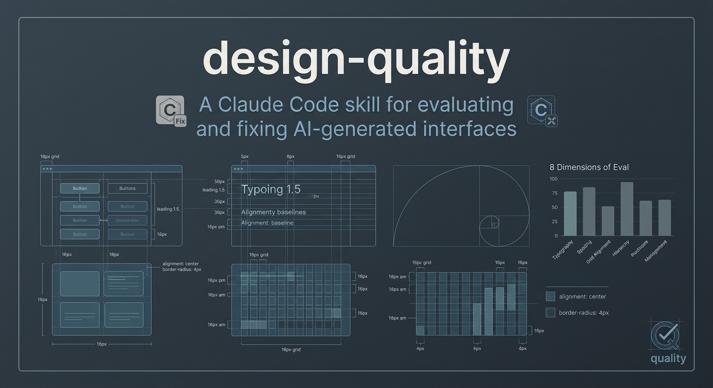

**English** · [Español](README.es.md) · [Português (Brasil)](README.pt-BR.md) · [简体中文](README.zh-CN.md) · [Français](README.fr.md) · [Deutsch](README.de.md) · [日本語](README.ja.md) · [한국어](README.ko.md)

---



# design-quality

A Claude Code skill for evaluating and fixing AI-generated interfaces.

AI generates UIs fast. It also generates them wrong — in the same ways, every time. Purple gradients, gradient text, glowing borders, emoji icons, card grids with no content, Inter-everything typography, generic hero headlines on operational tools. These are tells. This skill catches them, scores the interface on 8 dimensions, and fixes them pass by pass.

---

## What it does

**Review Mode** — audits a UI for AI slop signs, scores it on 8 dimensions (1–10), and produces a prioritized fix list (P0–P3).

**Create Mode** — sets a product direction before writing any UI. Refuses to start without one. Derives character, world, moments, and a signature detail from what the product actually does — not from trends.

**Fix Mode** — applies fixes in 10 sequential passes: spacing → color → icons → copy → typography → layout → details → accessibility → visuals → motion.

**Polish Mode** — for interfaces that are mostly designed but feel slightly off. Slows to 10% speed in DevTools and walks every state.

Works on React, Tailwind, HTML/CSS, Vue, Svelte, dashboards, apps, landing pages, components.

---

## Quick start

### With Claude Code (CLI)

```bash
# Install globally
claude skills install https://github.com/[your-handle]/design-quality

# Or copy directly
cp -r skills/design-quality ~/.claude/skills/
```

Then in any Claude Code session, the skill loads automatically when you ask Claude to review, critique, or build a UI.

### With Cursor / Windsurf / any Claude-powered editor

Copy the `skills/design-quality/` folder anywhere visible to your agent. In the agent configuration, point to `SKILL.md` as a context file or system prompt addition.

### With Claude.ai Projects

Upload `skills/design-quality/SKILL.md` and all files in `skills/design-quality/references/` as project knowledge. Claude will apply the skill to UI-related requests.

### Trigger phrases

The skill activates on:
- "review this design"
- "critique this UI"
- "does this look AI-generated?"
- "unslop this"
- "make it less generic"
- "build this page"
- "design this screen"
- "polish this interface"
- "improve the UI"
- "redesign"

---

## The problem this solves

### What AI UIs look like

When an LLM generates a UI without constraints, it produces the same interface every time. It has seen thousands of Dribbble shots, portfolio pieces, and SaaS landing pages. It optimizes for "impressive at a glance" rather than "useful in practice."

The result is always recognizable:

**Color:** Purple-to-blue gradient background. Gradient text with `background-clip: text`. Glowing colored borders. Radial blobs behind content.

**Typography:** Oversized hero headlines on operational tools. ALL CAPS tracked labels on every section. Emoji mixed into labels ("🚀 Launch", "New ✨"). Only Inter or Roboto with no other typographic decision.

**Layout:** Three-column card grid used as filler. Everything centered. Dark theme applied without product reason. Every section the same spacing.

**Copy:** "Revolutionize Your Workflow Today." "Powerful integrations." "Advanced Analytics." Copy that could belong to any product in the category.

**Identity:** If you swapped the product name for any competitor, the interface would still fit. No World, no Signature, no Moments — nothing that only this product would have.

### What this skill does differently

It catches these patterns systematically, scores what's there, and fixes in the right order. It also prevents them upfront by requiring a product direction before writing any UI.

---

## Modes

### Review Mode

Input: screenshot, HTML/CSS source, project folder, URL, or artifact link.

Output:
```
## Slop Audit
[each finding with location and severity]

## Template Check
[would this fit any product in the category?]

## Scorecard
Product fit:    X/10   [one-line note]
Hierarchy:      X/10
Clarity:        X/10
Taste:          X/10
Restraint:      X/10
Density:        X/10
Craft:          X/10
Responsiveness: X/10
Overall:        X/10

## Verdict
Best part:
Worst part:
Required fix (P0): [if any]
Quick wins (P1): [top 3]
```

Severity scale:
- **P0** — breaks usability or readability. Fix before anything else.
- **P1** — makes it look clearly AI-generated.
- **P2** — weakens the craft but doesn't break it.
- **P3** — nice-to-have improvement.

### Create Mode

Before writing any UI, the skill gates on:
1. **Context type** — app screen (density governs) vs. page (composition governs)
2. **Product understanding** — what it does, who it's for, what the primary task is
3. **Direction** — five lines derived from the product: Product, Character, World, Moments, Signature
4. **Design Dials** — three knobs as quick signal: Variance / Motion / Density (1–10 each)

After confirmation, it creates a `PROJECT_DESIGN.md` in the project root that persists the direction across sessions. Future sessions read this file first — direction doesn't drift.

Direction example for a time-tracking tool:
```
Product: Time tracking for freelancers who hate tracking time.
Character: calm, exact, a little warm
World: Watches, clocks, quiet focus sessions
Moments: The week view where hours accumulate; the invoice generation moment
Signature: A subtle ticking second-hand animation on the active timer
```

### Fix Mode

Ten sequential passes — complete each before starting the next:

1. **Spacing** — 8px grid alignment, rhythm, grouping
2. **Color** — remove slop, build from a neutral ramp
3. **Icons** — one library, one size, one stroke weight, `currentColor`
4. **Copy** — remove emoji labels, calm the shouting, make copy product-specific
5. **Typography** — hierarchy, weights, `text-wrap: balance` on headings
6. **Layout** — alignment, density
7. **Details** — concentric radii, shadows (not both shadow AND border), borders
8. **Accessibility & Touch** — focus states, `aria-label`, `touch-action: manipulation`, 44px targets
9. **Visuals** — empty state illustrations, icon consistency, image aspect ratios
10. **Motion** — last pass, only where it adds meaning

### Polish Mode

For interfaces that are mostly designed but feel subtly off.

Technique: slow the interface to 10% speed in browser DevTools (Animations panel). Walk every state: hover, focus, active, loading, empty. What feels off at 10% is what's wrong at full speed.

---

## Scorecard dimensions

| Dimension | The question it asks |
|---|---|
| **Product fit** | Does the visual direction match the product's actual job and audience? |
| **Hierarchy** | Can the user see what matters first, second, third? |
| **Clarity** | Are labels, actions, data, and states easy to understand? |
| **Taste** | Does it feel intentional without looking templated? |
| **Restraint** | No unnecessary decoration, filler, or style cosplay? |
| **Density** | Is the amount of information right for the task? |
| **Craft** | Spacing, type, alignment, contrast, component states — polished? |
| **Responsiveness** | Does the design survive mobile and narrow layouts? |

### What each score means

**Product fit:**
- 9–10: Only this product could look like this
- 7–8: Clearly aligned with the category, a few generic choices
- 5–6: Could belong to several products — safe but not specific
- 3–4: Generic SaaS applied regardless of what the product does
- 1–2: Design actively contradicts the product

**Hierarchy:**
- 9–10: The primary action is obvious, secondary recedes, tertiary is discoverable
- 5–6: Requires effort to parse — multiple things competing at equal weight
- 1–2: Decorative elements draw more attention than functional ones

**Craft:**
- 9–10: 8px grid everywhere, all states handled, contrast checked
- 5–6: Good intent, uneven execution — grid breaks, missing states
- 1–2: No discernible grid or type system

**Responsiveness:**
- 9–10: Works at 375px / 768px / 1024px / 1440px, mobile is thoughtful not just stacked
- 3–4: Broken or cramped on mobile, touch targets too small
- 1–2: No responsive consideration, unusable on mobile

---

## Anti-patterns detected

### Color & Effects (100+ patterns)

| Pattern | Severity |
|---|---|
| Purple-to-blue gradient on background, card, or button | P1 |
| Any hue-to-hue gradient on a surface | P1 |
| Gradient text (`background-clip: text`) | P1 |
| Glowing border (`box-shadow` with saturated color) | P1 |
| Radial color blob / atmospheric wash behind content | P1 |
| Background that reads as a hue on an app screen | P1 |
| Colored shadow on cards or buttons | P2 |
| "Glassmorphism" blur without a meaningful layering reason | P2 |

### Typography

| Pattern | Severity |
|---|---|
| Emoji in labels or headings ("New ✨", "🚀 Launch") | P1 |
| ALL CAPS tracked labels on every section header | P1 |
| Oversized hero headline on a functional operational tool | P1 |
| Copy that shouts ("Revolutionize Your Workflow Today") | P1 |
| Only Inter with no other typographic decision | P2 |
| No visual weight difference between heading and body | P1 |

### Layout & Structure

| Pattern | Severity |
|---|---|
| Evenly-spaced 3-column card grid used as content filler | P1 |
| Duplicate feature cards (icon + heading + two sentences each) | P1 |
| Dark dashboard applied by default with no product reason | P1 |
| Section exists only to fill space (fake stats, invented testimonials) | P1 |
| No visual hierarchy — every element the same weight | P1 |
| Everything centered, no left-aligned reading pattern | P2 |

### Icons

| Pattern | Severity |
|---|---|
| Emoji used as icons in navigation or cards | P1 |
| Two or more icon libraries mixed on one screen | P2 |
| Icons with their own colors (not `currentColor`) | P2 |
| Decorative icons before every heading or label | P2 |

### Template Identity

| Pattern | Severity |
|---|---|
| Swap product name for competitor — UI still fits | P1 |
| No Signature detail — nothing only this product would have | P1 |
| No World reference — neutrals have no tint toward the product's domain | P2 |
| Generic stock illustration that could belong to any product | P2 |

### Accessibility & Technical

| Pattern | Severity |
|---|---|
| Text contrast below 4.5:1 (WCAG AA) | P0 |
| No visible focus indicator on interactive elements | P0 |
| Icon button with no `aria-label` | P1 |
| Form input with no associated `<label>` | P1 |
| `user-scalable=no` in viewport meta | P1 |
| `prefers-reduced-motion` not respected | P1 |
| `transition: all` instead of specific properties | P2 |
| Chart labels overlapping | P0 |

### Mobile & Touch

| Pattern | Severity |
|---|---|
| Touch targets smaller than 44×44px | P1 |
| Hover effects without `@media (hover: hover)` guard | P2 |
| `touch-action: manipulation` missing on buttons | P2 |
| `overscroll-behavior: contain` missing on modals | P2 |

---

## Direction framework

The five lines every design needs before writing code:

**Product** — what it does and for whom, one plain sentence.

**Character** — 2–3 concrete words. `calm, exact, a little warm` or `fast, technical, playful`.
Banned: clean, modern, sleek, minimal, premium. These describe every template.

**World** — the material or place the product belongs to naturally.
- Note app → paper and ink
- Monitoring tool → instruments and night shifts
- Travel app → maps and window light
- Finance tool → ledgers, clean columns, quiet authority

This tints the neutrals, the accent, and the visual moments.

**Moments** — 1–2 places on the screen where the design gets rich and specific.
Everything else stays quiet so these read instantly.

**Signature** — one small detail only this product would have, repeated consistently.
- Monitoring tool → live status dot
- Developer tool → keycap aesthetic
- Delivery app → route line

One detail, not five.

### Design Dials

Three knobs shown for each direction proposal:

```
Variance  ░░░░░░░░░░  1–10   (1 = centered/minimal, 10 = bold/asymmetric)
Motion    ░░░░░░░░░░  1–10   (1 = static, 10 = animated)
Density   ░░░░░░░░░░  1–10   (1 = spacious/editorial, 10 = dashboard/dense)
```

### PROJECT_DESIGN.md

After direction is confirmed, the skill creates this file in the project root:

```markdown
# PROJECT_DESIGN.md

## Direction: [Name]
Product: [one sentence]
Character: [2–3 words]
World: [material / place]
Moments: [1–2 specific places]
Signature: [one detail]

## Dials
Variance: X/10
Motion: X/10
Density: X/10

## Palette
Canvas: [token + hex]
Accent: [token + hex]
Text primary: [token + hex]
Text muted: [token + hex]

## Typography
Display: [font name + weight]
Body: [font name + weight]
Mono: [font name] (if applicable)

## Border radius: [value]px
```

Future sessions read this first. Direction doesn't drift across long projects.

---

## Design principles applied

### Spacing
- 8px grid. All margins, paddings, gaps are multiples of 4 or 8.
- `mt-[13px]` is always wrong. Fix it.
- Space shows grouping: inner gap < outer gap. A section label sits closer to its own items than to the section above.

### Color
- One neutral ramp, tinted toward the World.
- One accent, used rarely: primary action, selection, the one number that matters.
- Three text roles: primary, secondary, muted. Never ten slightly different grays.
- Prefer OKLCH for new color tokens: `oklch(L% C H)` — perceptually uniform, easier to adjust.
- Banned: hue gradients on surfaces, gradient text, colored glows, radial blobs, neon borders.

### Typography
- Pair a distinctive display font with a clean body font. Maximize weight contrast.
- `text-wrap: balance` on all headings. `text-wrap: pretty` on body text.
- `-webkit-font-smoothing: antialiased` on `:root` (macOS renders crisper).
- Minimum 14px body text (prefer 16px). One h1 per page.

### Components
- Buttons: verb-first labels. One primary per section.
- No emoji as icons. One icon library, one stroke weight, `currentColor` only.
- Cards: shadow OR border, not both.
- Empty states: illustration + headline + CTA. Never just empty.
- Loading: skeleton screens (not spinners) after 300ms delay.

### One Bright Element Rule
Each screen gets one polished, rich element. Everything around it stays quiet.
The chrome (navigation, buttons, backgrounds) never competes with the content.

---

## Polish checklist

Before marking any UI done:

- [ ] No emoji as icons (use SVG: Heroicons / Lucide / Phosphor / Radix)
- [ ] `cursor-pointer` on all clickable elements
- [ ] Text contrast ≥ 4.5:1 (WCAG AA)
- [ ] Focus states visible for keyboard navigation (`focus-visible`, not removed `outline`)
- [ ] `aria-label` on every icon button
- [ ] `<label>` associated with every form input
- [ ] `prefers-reduced-motion` respected
- [ ] `touch-action: manipulation` on buttons
- [ ] Hover states use `@media (hover: hover) and (pointer: fine)`
- [ ] Text, chips, and badges reflow at narrow widths without clipping
- [ ] Responsive at 375px, 768px, 1024px, 1440px
- [ ] No P0 findings from Review Mode
- [ ] Empty, loading, and error states all handled
- [ ] Dynamic numbers use `font-variant-numeric: tabular-nums`
- [ ] Headings have `text-wrap: balance`
- [ ] No `transition: all` anywhere

---

## Felt State Check

A check the skill runs during Review Mode. It asks what the user is feeling at each key state, then checks whether the interface acknowledges those feelings.

Loading: anxious? Waiting?
Empty state: lost? First time?
Error: embarrassed?

Flag when:
- Loading copy is "Loading..." → P2 (should be "Getting your data" or similar)
- Error message blames the user for a system failure → P1
- Empty state offers nothing — no instruction, no CTA → P1
- Success is absorbed silently (no acknowledgment) → P2

---

## Peak-End Rule

For multi-step flows, the skill maps the two moments that dominate how the flow is remembered:

- **Peak**: the most emotionally intense moment (order placed, form submitted, first result). Is it well-designed?
- **End**: the final screen/state. Does it confirm clearly and land warm?

Ending on an administrative screen, a confusing status page, or an unresolved error → P1.

---

## Micro-polish values

### Concentric border radius

Outer element radius = inner element radius + the padding between them.

```css
/* Wrong */
.card { border-radius: 12px; padding: 16px; }
.card-inner { border-radius: 12px; } /* too small — inner corners are blunt */

/* Correct */
.card { border-radius: 24px; padding: 12px; }
.card-inner { border-radius: 12px; } /* 24 - 12 = 12 ✓ */
```

### Press animation

```css
button {
  transition: transform 150ms ease-out;
}
button:active {
  transform: scale(0.96);
}
```

Always 0.96 — never smaller than 0.95.

### Transitions

```css
/* Never */
transition: all 200ms ease;

/* Always specify */
transition: transform 200ms ease-out, opacity 200ms ease-out;
```

### Touch targets

```css
/* Small icon button with extended hit area */
.icon-button {
  width: 20px;
  height: 20px;
  position: relative;
}
.icon-button::before {
  content: '';
  position: absolute;
  inset: -12px; /* extends hit area to 44×44 without changing layout */
}
```

---

## Motion principles

Motion is a budget. Ask for every animation: does removing it make the interface worse, or just less flashy? If the answer is "just less flashy," remove it.

**High-frequency interactions (used >10×/day): no custom animation.**
Row hover, keystroke feedback, tab switch, toggle — instant response or minimal transition at ≤150ms.

**Low-frequency actions (used rarely or first time only): earn animation.**
Onboarding steps, empty state → first item, success states — 150–300ms with simple ease-out.

**CSS transitions over keyframes for interactive elements.**
Transitions are interruptible. If a user opens a drawer and closes it mid-animation, a transition reverses smoothly. A keyframe animation restarts from the beginning.

---

## Repository structure

```
design-quality/
├── README.md              ← this file
├── README.pt-BR.md        ← Portuguese
├── CHANGELOG.md
├── CONTRIBUTING.md
├── LICENSE
├── skills/
│   └── design-quality/
│       ├── SKILL.md       ← the installable skill
│       └── references/
│           ├── slop-signs.md
│           ├── micro-polish.md
│           ├── quality-dimensions.md
│           ├── passes-visuals.md
│           ├── passes-motion.md
│           └── designer-skills-index.md
└── docs/
    ├── review-guide.md
    ├── fix-mode-walkthrough.md
    └── slop-field-guide.md
```

---

## Contributing

See [CONTRIBUTING.md](CONTRIBUTING.md) for how to add slop signs, propose new dimensions, or contribute translations.

---

## Related

- [designer-skills](https://github.com/Owl-Listener/designer-skills) — 111 focused design skills that this skill references for deep dives
- [impeccable](https://github.com/pbakaus/impeccable) — design standards for AI-generated interfaces

---

## License

MIT — see [LICENSE](LICENSE).
