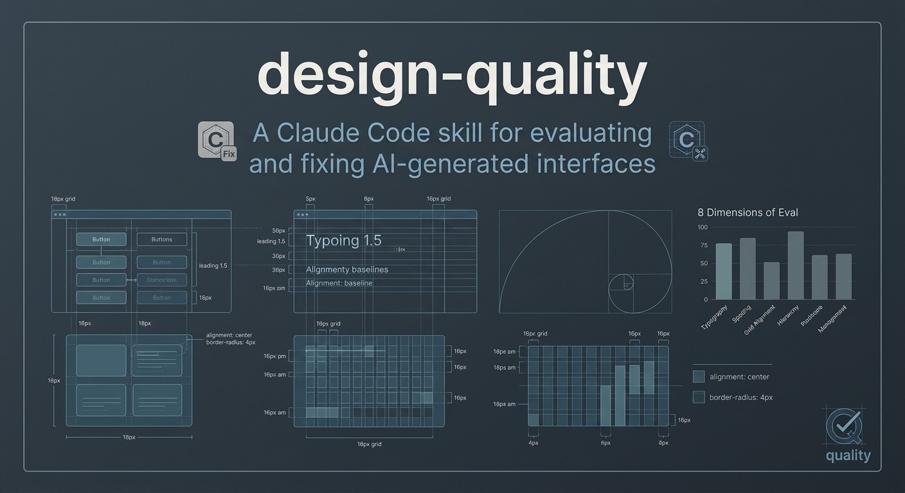
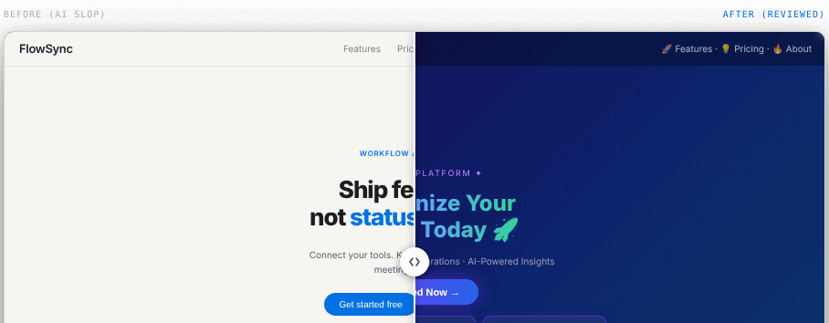

[English](README.md) · [Español](README.es.md) · [Português (Brasil)](README.pt-BR.md) · **简体中文** · [Français](README.fr.md) · [Deutsch](README.de.md) · [日本語](README.ja.md) · [한국어](README.ko.md)

---

    

**[→ 在线演示: romulorogerio.github.io/design-quality](https://romulorogerio.github.io/design-quality)**



## Demo



# design-quality

一个面向AI编程助手的设计质量技能 — 适用于Claude Code、Cursor、Codex、Copilot或任何接受Markdown指令的工具。

AI 生成 UI 很快，也总是以相同的方式出错。紫蓝色渐变、渐变文字、彩色发光边框、用 emoji 充当图标、没有内容的卡片网格、清一色 Inter 字体、在操作工具上用夸张的大标题。这些都是典型特征。这个技能会系统性地检测它们，从 8 个维度对界面打分，并逐步修复问题。

适用于 React、Tailwind、HTML/CSS、Vue、Svelte、仪表板、应用程序、落地页、组件。


---

## 快速开始

### 使用 Claude Code（CLI）

```bash
# 全局安装
claude skills install https://github.com/RomuloRogerio/design-quality

# 或直接复制
cp -r skills/design-quality ~/.claude/skills/
```

之后，在任何 Claude Code 会话中，当你要求 Claude 审查、评价或构建 UI 时，技能会自动加载。

<details>
<summary>🔍 终端输出示例: Review 模式</summary>

```
$ claude review this design

🤖 [design-quality] Analyzing repository and screenshot context...
✨ Found 4 AI-slop indicators. Evaluating against 8-dimension scorecard.

## Slop Audit
❌ Purple-to-blue gradient background (P1) — App.css line 12
❌ Gradient text with background-clip (P1) — HeroTitle component
❌ Emoji in navigation label "🚀 Launch" (P1) — Navbar.tsx
❌ ALL CAPS tracked section header (P1) — features section

## Template Check
Could this UI belong to any other SaaS product? YES → P1
No World reference, no Signature detail found.

## Scorecard
Product fit:    4/10   generic SaaS applied
Hierarchy:      6/10   primary action visible but competing elements
Clarity:        7/10   labels readable, states missing
Taste:          3/10   templated
Restraint:      2/10   excessive decoration
Density:        6/10   appropriate for content
Craft:          5/10   grid inconsistent in footer
Responsiveness: 7/10   mobile layout works
Overall:        5/10

## Verdict
Best part: clear primary CTA, readable label
Worst part: gradient + gradient text — maximum slop signal
Required fix (P0): none
Quick wins (P1): remove gradient background, strip gradient text, replace emoji icons
```

</details>

### 使用任何AI助手（Cursor、Codex、Copilot、Gemini等）

将技能文件内容直接粘贴到聊天中，或作为上下文/系统提示添加：

```
# 在AI聊天中：
"使用此技能审查我的界面：[粘贴 skills/design-quality/SKILL.md 的内容]"

# 或在代理配置中引用文件：
skills/design-quality/SKILL.md   → 界面审查
skills/ant-design.md              → Ant Design审计
skills/system-design.md           → 架构规划
skills/all.md                     → 全部三个技能
```

技能文件是纯Markdown格式，无需Claude Code依赖。插件（斜杠命令）仅支持Claude Code。

### 使用 Claude.ai 项目

将 `skills/design-quality/SKILL.md` 和 `skills/design-quality/references/` 中的所有文件作为项目知识上传。Claude 会将该技能应用于 UI 相关的请求。

---

## 使用示例

**审查 UI 并评分：**
```
审阅这个设计
评价这个 UI
这看起来是 AI 生成的吗？
去掉 AI 味
```

**先确立产品方向，再开始新 UI：**
```
为车队监控工具构建一个仪表板
设计自由职业者账单应用的引导流程
```

**对现有代码执行修复 Pass：**
```
修复这个组件的间距和颜色
对 App.tsx 执行完整修复 Pass
```

**应用品牌套件（品牌手册、Token JSON、Logo、应用案例）：**
```
帮我读一下这份品牌手册，然后再开始设计
把这个品牌风格应用到落地页上
这个仪表板是否符合品牌规范？
```

**Ant Design 审查：**
```
对照 Ant Design 标准审查这个 React Admin 面板
检查这个组件是否符合 Ant Design Token 规范
```

**架构规划：**
```
设计一个支持每天 1 亿次请求的短链接服务
如何大规模存储和分发用户上传的视频？
```

---

## 本仓库中的 Skills

| Skill | 文件 | 用途 |
|---|---|---|
| **design-quality** | [`skills/design-quality/SKILL.md`](skills/design-quality/SKILL.md) | 通用 UI 审查、AI 劣质检测、8 维度评分卡、品牌套件读取、Brand/Create/Fix/Polish 模式 |
| **ant-design** | [`skills/ant-design.md`](skills/ant-design.md) | Ant Design v6 审查: Token、组件、4px 栅格、动效、层级 |
| **system-design** | [`skills/system-design.md`](skills/system-design.md) | 可扩展架构: 5 步框架、数据库选型、缓存、消息队列、CAP |
| **all** | [`skills/all.md`](skills/all.md) | 一次加载全部三个；Claude 自动选择适用的 Skill |

---

## 插件（Claude Code 斜杠命令）

`plugin/` 文件夹为任意 Claude Code 会话添加五个斜杠命令和状态栏提示。

| 命令 | 功能 |
|---|---|
| `/dq-review` | 完整 UI 审计：AI 劣质检测、8 维度评分卡、P0–P3 修复清单 |
| `/direction` | Create 模式: 在编写任何 UI 代码前推导方向（角色 · 世界 · 时刻 · 签名细节） |
| `/fix` | Fix 模式: 10 个顺序修复 Pass：间距 → 颜色 → 图标 → 文案 → 字体 → 布局 → 细节 → 无障碍 → 视觉 → 动效 |
| `/polish` | Polish 模式: 以 10% 速度遍历每个状态（hover · focus · active · loading · empty · error） |
| `/brand` | 读取品牌套件（品牌手册、Token JSON、Logo、应用案例），生成经过确认的 `BRAND.md` |

编辑任意 `.tsx`、`.jsx`、`.css`、`.scss`、`.html`、`.vue` 或 `.svelte` 文件后，状态栏显示 `/dq-review · /fix · /polish` 提醒。

**安装：**
```bash
# 克隆仓库
git clone https://github.com/RomuloRogerio/design-quality

# 以插件模式启动 Claude Code
claude --plugin-dir ~/design-quality/plugin
```

**或永久加载:** 添加到 `~/.claude/settings.json`：
```json
{
  "pluginDirs": ["~/design-quality/plugin"]
}
```

---

## 解决的问题

### AI 界面的外观

当 LLM 在没有约束的情况下生成 UI 时，每次都会产生相同的界面。它见过数千张 Dribbble 截图、作品集和 SaaS 落地页，优化目标是"乍看很惊艳"而非"实际使用很有用"。

结果总是那么熟悉：

**颜色：** 紫蓝色渐变背景。带 `background-clip: text` 的渐变文字。彩色发光边框。内容背后的径向色块。

**排版：** 在操作工具上用超大英雄标题。每个章节都用跟踪字距的全大写标签。标签里混用 emoji（"🚀 启动"、"全新 ✨"）。只用 Inter 或 Roboto，没有其他排版决策。

**布局：** 用三列卡片网格充当内容填充。所有内容居中。无任何产品原因地默认使用深色主题。每个部分间距相同。

**文案：** "今天就彻底改变你的工作流程。" "强大的集成能力。" "高级分析。" 适用于同类任何产品的文案。

**个性：** 把产品名换成任何竞争对手，界面依然适配。没有世界观、没有签名、没有高光时刻——没有任何只属于这个产品的元素。

### 这个技能的不同之处

它系统性地检测这些模式，对现有内容评分，并按正确顺序修复。它还通过要求在编写任何 UI 之前先有产品方向来从源头预防问题。

---

## 模式

### 品牌模式

输入：品牌套件。放入 `brand/` 文件夹或在聊天中附加文件：

```
brand/
  miv.pdf          品牌视觉手册（PDF 或页面图片）
  tokens.json      设计 Token 或品牌 JSON，任意格式均可
  logos/           优先 SVG，PNG 亦可
  applications/    品牌应用照片或截图
```

Skill 会逐页阅读手册，将 JSON 转换为 W3C 设计 Token 格式，整理 Logo 并分析应用案例，然后输出包含 Logo 规范、官方色值、字体、品牌语调、品牌例外和受保护 Token 的 `BRAND.md`，并请求确认。

之后所有模式都在品牌规范内运行：
- **Review** 新增品牌忠实度代理和第 9 个评分维度
- **Create** 使用品牌色板和字体
- **Fix** 不会修改品牌颜色、字体和 Logo
- 手册中已记录的模式（如官方渐变）在适当场景下不视为劣质特征

Logo 始终使用提供的文件：禁止用文字或 CSS 重建、变色或拉伸变形。

### 审阅模式

输入：截图、HTML/CSS 源码、项目文件夹、URL 或构件链接。

输出：
```
## AI 劣质特征审计
[每条发现，含位置和严重程度]

## 模板检查
[这个界面能适配同类任何产品吗？]

## 评分卡
产品契合度：    X/10   [一行说明]
层次结构：      X/10
清晰度：        X/10
品味：          X/10
克制度：        X/10
信息密度：      X/10
工艺：          X/10
响应式：        X/10
品牌忠实度：    X/10   [仅在存在 BRAND.md 时]
综合：          X/10

## 结论
最好的部分：
最差的部分：
必须修复（P0）：[如有]
快速改进（P1）：[前 3 条]
```

严重程度等级：
- **P0:** 破坏可用性或可读性，优先修复。
- **P1:** 明显看起来是 AI 生成的。
- **P2:** 削弱工艺但不影响功能。
- **P3:** 锦上添花的改进。

### 创建模式

编写任何 UI 之前，技能要求：
1. **上下文类型:** 应用界面（密度主导）还是页面（构图主导）
2. **产品理解:** 产品是什么、面向谁、核心任务是什么
3. **方向:** 从产品中推导的五条线：产品、特质、世界观、高光时刻、签名
4. **设计仪表盘:** 三个快速信号旋钮：变化度 / 动效度 / 密度（各 1–10）

确认后，在项目根目录创建 `PROJECT_DESIGN.md` 文件，跨会话持久化方向。后续会话首先读取此文件——方向不会偏离。

时间追踪工具的方向示例：
```
产品：为讨厌追踪时间的自由职业者设计的时间追踪工具。
特质：冷静、精确、略带温度
世界观：手表、时钟、安静的专注时段
高光时刻：显示累积工时的周视图；生成发票的时刻
签名：计时器激活时表盘秒针的微妙动画
```

### 修复模式

十个顺序阶段——完成每个阶段后再开始下一个：

1. **间距:** 8px 网格对齐、节奏、分组
2. **颜色:** 移除劣质元素，从中性色调构建
3. **图标:** 一套图标库、一种尺寸、一种描边粗细、`currentColor`
4. **文案:** 移除 emoji 标签，平息过度叫卖，使文案专属于产品
5. **排版:** 层次、字重、标题用 `text-wrap: balance`
6. **布局:** 对齐、密度
7. **细节:** 同心圆角、阴影（不能同时有阴影和边框）、边框
8. **无障碍与触控:** 焦点状态、`aria-label`、`touch-action: manipulation`、44px 触控目标
9. **视觉:** 空状态插画、图标一致性、图片宽高比
10. **动效:** 最后一个阶段，只在增加意义时使用

### 打磨模式

针对设计基本完成但感觉微微不对的界面。

技巧：在 DevTools 动效面板中以 10% 速度减慢界面。逐一检查每个状态：hover、focus、active、loading、empty。10% 速度下感觉不对的，就是全速时出问题的地方。

---

## 评分卡维度

| 维度 | 提出的问题 |
|---|---|
| **产品契合度** | 视觉方向是否与产品的实际功能和目标用户相符？ |
| **层次结构** | 用户能否看出什么最重要、次重要、第三重要？ |
| **清晰度** | 标签、操作、数据和状态是否易于理解？ |
| **品味** | 感觉有设计意图，同时不像模板？ |
| **克制度** | 没有不必要的装饰、填充或风格堆砌？ |
| **信息密度** | 信息量是否适合任务需求？ |
| **工艺** | 间距、排版、对齐、对比度、组件状态——精致吗？ |
| **响应式** | 设计能否在移动端和窄屏布局中正常呈现？ |
| **品牌忠实度** _(仅在存在 BRAND.md 时)_ | 界面是否与品牌视觉标识、Token 和使用规范相符？ |

---

## 检测到的反模式

### 颜色与效果（100+ 种模式）

| 模式 | 严重程度 |
|---|---|
| 背景、卡片或按钮上的紫蓝色渐变 | `P1` |
| 任何表面上的色相渐变 | `P1` |
| 渐变文字（`background-clip: text`） | `P1` |
| 发光边框（饱和色的 `box-shadow`） | `P1` |
| 内容背后的径向色块 / 氛围光晕 | `P1` |
| 应用界面背景读起来像色相 | `P1` |
| 卡片或按钮上的彩色阴影 | `P2` |
| 没有有意义分层原因的"玻璃拟态"模糊 | `P2` |

### 排版

| 模式 | 严重程度 |
|---|---|
| 标签或标题中的 emoji（"全新 ✨"、"🚀 启动"） | `P1` |
| 每个章节标题都用跟踪字距的全大写标签 | `P1` |
| 功能操作工具上的超大英雄标题 | `P1` |
| 叫卖式文案（"今天就彻底改变你的工作流程"） | `P1` |
| 只用 Inter，没有其他排版决策 | `P2` |
| 标题与正文之间没有视觉字重差异 | `P1` |

### 布局与结构

| 模式 | 严重程度 |
|---|---|
| 等距三列卡片网格充当内容填充 | `P1` |
| 重复的功能卡（图标 + 标题 + 两句话） | `P1` |
| 默认深色仪表板，没有产品原因 | `P1` |
| 仅为填充空间而存在的章节（虚假数据、编造的用户评价） | `P1` |
| 没有视觉层次——所有元素权重相同 | `P1` |
| 全部居中，没有左对齐阅读模式 | `P2` |

### 图标

| 模式 | 严重程度 |
|---|---|
| 导航或卡片中用 emoji 充当图标 | `P1` |
| 同一界面混用两种或更多图标库 | `P2` |
| 图标有自己的颜色（不是 `currentColor`） | `P2` |
| 每个标题或标签前都有装饰性图标 | `P2` |

### 模板身份

| 模式 | 严重程度 |
|---|---|
| 把产品名换成竞争对手——UI 依然适配 | `P1` |
| 没有签名细节——没有任何只属于这个产品的东西 | `P1` |
| 没有世界观参考——中性色调没有向产品领域倾斜 | `P2` |
| 适用于任何产品的通用配图 | `P2` |

### 无障碍与技术

| 模式 | 严重程度 |
|---|---|
| 文字对比度低于 4.5:1（WCAG AA） | `P0` |
| 交互元素上没有可见的焦点指示器 | `P0` |
| 图标按钮没有 `aria-label` | `P1` |
| 表单输入没有关联的 `<label>` | `P1` |
| viewport meta 中有 `user-scalable=no` | `P1` |
| 不尊重 `prefers-reduced-motion` | `P1` |
| 使用 `transition: all` 而非具体属性 | `P2` |
| 图表标签重叠 | `P0` |

### 移动端与触控

| 模式 | 严重程度 |
|---|---|
| 触控目标小于 44×44px | `P1` |
| 悬停效果没有 `@media (hover: hover)` 防护 | `P2` |
| 按钮上缺少 `touch-action: manipulation` | `P2` |
| 模态框上缺少 `overscroll-behavior: contain` | `P2` |

---

## 方向框架

每个设计在写代码前需要的五条线：

**产品:** 它做什么、为谁做，一句话。

**特质:** 2–3 个具体词汇。`冷静、精确、略带温度` 或 `快速、技术感、有趣`。
禁用词：干净、现代、优雅、简约、高端。这些词适用于所有模板。

**世界观:** 产品自然归属的材质或场所。
- 笔记应用 → 纸张与墨水
- 监控工具 → 仪器与夜班
- 旅游应用 → 地图与窗光
- 金融工具 → 账本、整洁的列、沉静的权威

这会影响中性色的色调、强调色和视觉高光时刻。

**高光时刻:** 界面上 1–2 个设计变得丰富而具体的地方。
其他地方保持安静，以便这些地方能即时被看到。

**签名:** 只有这个产品才会有的一个小细节，持续重复。
- 监控工具 → 实时状态点
- 开发者工具 → 按键帽美学
- 配送应用 → 路线线条

一个细节，不是五个。

### 设计仪表盘

每个方向提案都展示三个旋钮：

```
变化度  ░░░░░░░░░░  1–10   （1 = 居中/简约，10 = 大胆/非对称）
动效度  ░░░░░░░░░░  1–10   （1 = 静态，10 = 动画丰富）
密度    ░░░░░░░░░░  1–10   （1 = 宽松/编辑风，10 = 仪表板/高密度）
```

---

## 应用的设计原则

### 理论基础与设计心理学

本技能基于扎实的行为心理学和经典设计框架来评估界面，而非瞬息万变的审美趋势：

- **峰终定律（Daniel Kahneman）：** 用户对体验的判断来自峰值时刻和结束时刻——而非整体平均。这就是为什么本技能特别关注每个流程中最强烈的交互和最终界面。
- **情感化设计框架（Don Norman）：** 界面必须同时兼顾三个层次——本能层（第一印象）、行为层（使用便利性）和反思层（意义与身份）。Product Fit 低于 7 分，往往意味着在反思层失败。
- **可供性（James J. Gibson / Don Norman）：** 交互元素必须在无需探索的情况下清晰传达其功能。缺失的焦点状态、无标签的图标按钮和不可见的触控目标都违反了这一原则。

---

### 间距
- 8px 网格。所有边距、内边距、间隙都是 4 或 8 的倍数。
- `mt-[13px]` 永远是错的，修正它。
- 间距体现分组关系：内部间距 < 外部间距。

### 颜色
- 一套中性色调，向世界观倾斜。
- 一个强调色，少量使用：主要操作、选中状态、最重要的那个数字。
- 三种文字角色：主要、次要、弱化。永远不要十种略有不同的灰色。
- 新颜色令牌优先使用 OKLCH：`oklch(L% C H)`: 感知均匀，更易调整。
- 禁止：表面上的色相渐变、渐变文字、彩色发光、径向色块、霓虹边框。

### 排版
- 将有个性的展示字体与干净的正文字体搭配。最大化字重对比。
- 所有标题用 `text-wrap: balance`，正文用 `text-wrap: pretty`。
- 在 `:root` 上设置 `-webkit-font-smoothing: antialiased`（macOS 渲染更清晰）。
- 正文最小 14px（建议 16px）。每页一个 h1。

### 组件
- 按钮：动词在前的标签。每个区域一个主要按钮。
- 不用 emoji 充当图标。一套图标库、一种描边粗细、只用 `currentColor`。
- 卡片：阴影或边框，二选一。
- 空状态：插画 + 标题 + CTA。永远不要只是空白。
- 加载：300ms 延迟后用骨架屏（不用 spinner）。

### 单一亮点规则
每个界面有一个精致丰富的元素，其余保持安静。
导航、按钮、背景等界面框架永远不与内容竞争视觉注意力。

---

## 打磨检查清单

在将任何 UI 标记为完成之前：

- [ ] 不用 emoji 充当图标（使用 SVG：Heroicons / Lucide / Phosphor / Radix）
- [ ] 所有可点击元素加 `cursor-pointer`
- [ ] 文字对比度 ≥ 4.5:1（WCAG AA）
- [ ] 键盘导航焦点状态可见（`focus-visible`，不移除 `outline`）
- [ ] 每个图标按钮都有 `aria-label`
- [ ] 每个表单输入都关联了 `<label>`
- [ ] 尊重 `prefers-reduced-motion`
- [ ] 按钮上有 `touch-action: manipulation`
- [ ] 悬停状态使用 `@media (hover: hover) and (pointer: fine)`
- [ ] 文字、标签和徽章在窄宽度下能换行而不被截断
- [ ] 在 375px、768px、1024px、1440px 下均正常响应
- [ ] 审阅模式无 P0 发现
- [ ] 空状态、加载状态和错误状态都已处理
- [ ] 动态数字使用 `font-variant-numeric: tabular-nums`
- [ ] 标题有 `text-wrap: balance`
- [ ] 任何地方都没有 `transition: all`

---

## 情感状态检查

技能在审阅模式中运行的检查。它询问用户在每个关键状态下的感受，然后检查界面是否承认这些感受。

加载中：焦虑？等待？
空状态：迷失？第一次？
错误：尴尬？

标记以下情况：
- 加载文案只是"加载中..." → P2（应该是"正在获取您的数据"等）
- 错误消息将系统故障归咎于用户 → P1
- 空状态什么都没有——没有说明、没有 CTA → P1
- 成功被无声吸收（没有任何反馈） → P2

---

## 峰终定律

对于多步骤流程，技能会映射主导人们记忆流程方式的两个时刻：

- **峰值**：情感最强烈的时刻（下单、提交表单、看到第一个结果）。设计得好吗？
- **终点**：最后的界面/状态。确认清晰、落地温暖吗？

以管理界面、令人困惑的状态页面或未解决的错误结束 → P1。

---

## 精细打磨数值

### 同心圆角

外层元素圆角 = 内层元素圆角 + 两者之间的内边距。

```css
/* 错误 */
.card { border-radius: 12px; padding: 16px; }
.card-inner { border-radius: 12px; } /* 太小——内角显得生硬 */

/* 正确 */
.card { border-radius: 24px; padding: 12px; }
.card-inner { border-radius: 12px; } /* 24 - 12 = 12 ✓ */
```

### 按压动画

```css
button {
  transition: transform 150ms ease-out;
}
button:active {
  transform: scale(0.96);
}
```

始终是 0.96——绝不低于 0.95。

### 过渡效果

```css
/* 绝不这样写 */
transition: all 200ms ease;

/* 始终指定具体属性 */
transition: transform 200ms ease-out, opacity 200ms ease-out;
```

### 触控目标

```css
.icon-button {
  width: 20px;
  height: 20px;
  position: relative;
}
.icon-button::before {
  content: '';
  position: absolute;
  inset: -12px; /* 将点击区域扩展到 44×44，不改变布局 */
}
```

---

## 动效原则

动效是一种预算。对每一个动画问自己：去掉它会让界面更差，还是只是少了点华丽？如果答案是"只是少了点华丽"，就去掉。

**高频交互（每天使用 >10 次）：不用自定义动画。**
行悬停、按键反馈、标签切换、开关——即时响应，或 ≤150ms 的最小过渡。

**低频操作（很少使用或第一次使用）：值得动画。**
引导步骤、空状态 → 第一项、成功状态——150–300ms 配合简单 ease-out。

**交互元素优先使用 CSS transition 而非 keyframe。**
transition 是可中断的。如果用户打开抽屉后在动画中途关闭，transition 会平滑反向播放。keyframe 动画则会从头开始。

---

## 仓库结构

```
design-quality/
├── README.md（+ 7 种语言翻译）
├── CHANGELOG.md
├── CONTRIBUTING.md
├── LICENSE
├── plugin/                     ← Claude Code 斜杠命令
│   ├── .claude-plugin/
│   └── hooks/
└── skills/
    ├── all.md                  ← 一次加载三个 Skills
    ├── ant-design.md           ← Ant Design v6 评审与修复
    ├── system-design.md        ← 可扩展架构规划
    └── design-quality/
        ├── SKILL.md
        └── references/
```

**快速导航：**

| 文件 | 描述 |
|---|---|
| [README.md](README.md) | 本文件（+ [es](README.es.md) · [pt-BR](README.pt-BR.md) · [zh-CN](README.zh-CN.md) · [fr](README.fr.md) · [de](README.de.md) · [ja](README.ja.md) · [ko](README.ko.md)） |
| [CHANGELOG.md](CHANGELOG.md) | 版本历史 |
| [CONTRIBUTING.md](CONTRIBUTING.md) | 如何贡献 |
| [LICENSE](LICENSE) | MIT 许可证 |
| **Skills** | |
| [skills/all.md](skills/all.md) | 一次加载全部三个 Skills |
| [skills/design-quality/SKILL.md](skills/design-quality/SKILL.md) | UI 审查、劣质检测、评分卡、Create/Fix/Polish |
| [skills/ant-design.md](skills/ant-design.md) | Ant Design v6 Token/组件审查 |
| [skills/system-design.md](skills/system-design.md) | 可扩展架构规划 |
| **插件** | |
| [plugin/hooks/register.ts](plugin/hooks/register.ts) | 斜杠命令 Hooks 源码 |
| [plugin/README.md](plugin/README.md) | 插件安装说明 |
| **参考资料** | |
| [slop-signs.md](skills/design-quality/references/slop-signs.md) | 完整反模式目录 |
| [quality-dimensions.md](skills/design-quality/references/quality-dimensions.md) | 评分维度详情 |
| [micro-polish.md](skills/design-quality/references/micro-polish.md) | 微打磨参考 |
| [passes-visuals.md](skills/design-quality/references/passes-visuals.md) | 视觉修复 Pass |
| [passes-motion.md](skills/design-quality/references/passes-motion.md) | 动效修复 Pass |
| [review-guide.md](docs/review-guide.md) | 审查模式指南 |
| [fix-mode-walkthrough.md](docs/fix-mode-walkthrough.md) | 修复模式指南 |
| [slop-field-guide.md](docs/slop-field-guide.md) | AI 劣质现场指南 |

---

## 贡献

参见 [CONTRIBUTING.md](CONTRIBUTING.md) 了解如何添加 AI 劣质特征、提议新维度或贡献翻译。

---

## 相关项目

- [designer-skills](https://github.com/Owl-Listener/designer-skills): 111 个专项设计技能，本技能在深入分析时会引用
- [impeccable](https://github.com/pbakaus/impeccable): AI 生成界面的设计标准

---

## 许可证

MIT: 参见 [LICENSE](LICENSE)。
